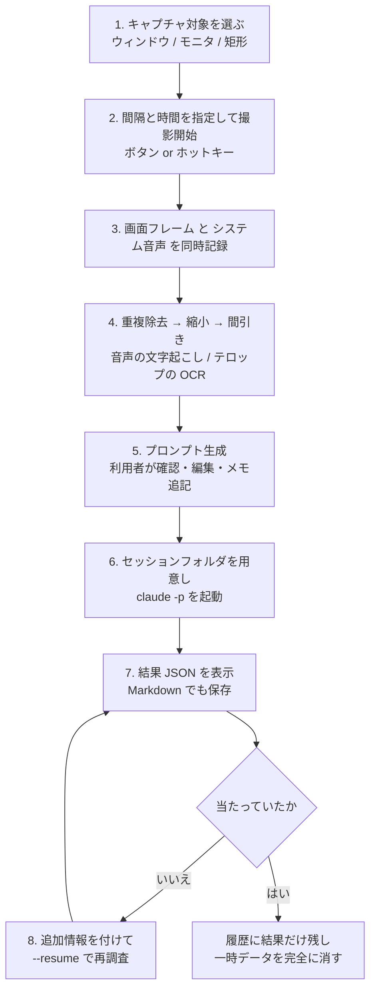
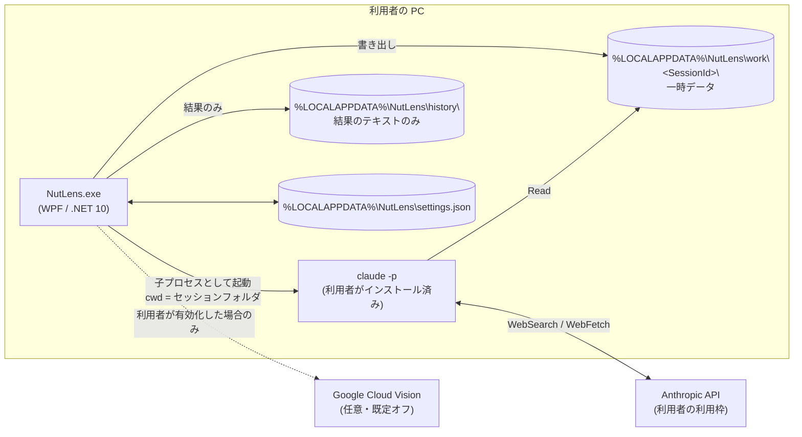
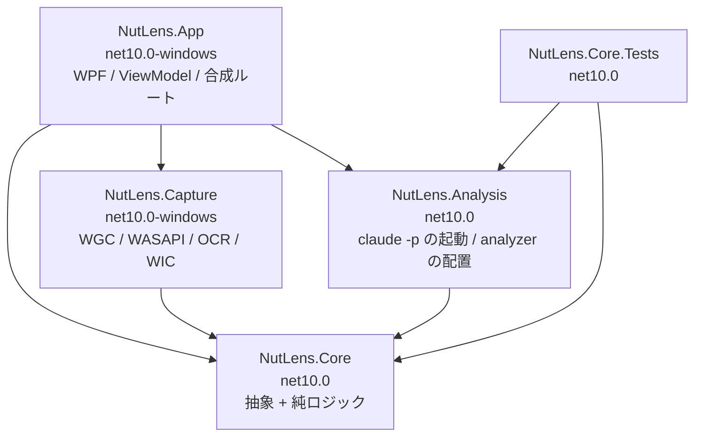
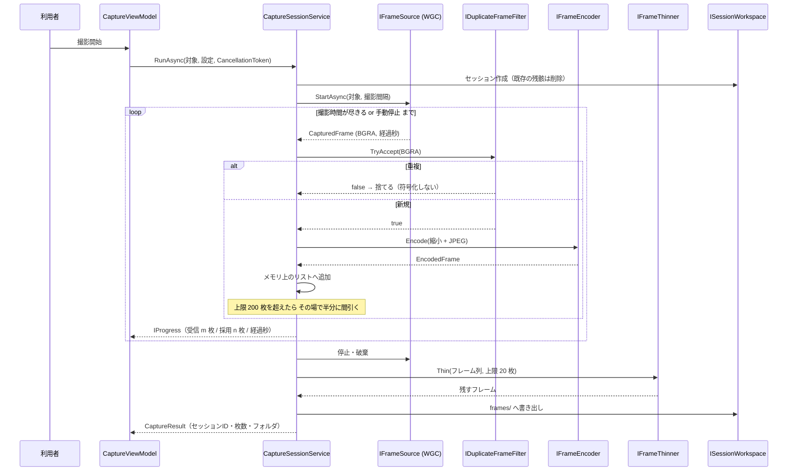

# NutLens 概要設計書

- 版：0.1（段階 1 時点）
- 最終更新：2026-11-14
- 対応する要件：`implementation-prompt.md`
- **この文書は設計の変更と同じ作業の中で更新する**（`CLAUDE.md` 参照）

---

## 1. このツールは何をするか

TikTok / YouTube Shorts などで流れる「映画紹介ショート動画（フリップ動画）」を**見ながら**、
その再生画面と音声をキャプチャし、ローカルの Claude Code に解析させて、
元になった映画・ドラマ・短編のタイトルを特定する Windows デスクトップアプリ。

動画ファイルのダウンロードは行わない。**再生中の画面と音声をキャプチャする方式のみ。**

### 1.1 やらないこと

| やらないこと | 理由 |
|---|---|
| 動画のダウンロード、URL からの自動取得 | 対象外（9 章） |
| **顔認識・人物の特定** | 仕様として明示的に除外（2 章）。手がかりはあらすじ・舞台・小道具・テロップ・ナレーションなど、人物以外の情報に限る |
| 動画の再生位置との同期 | 対象外。「秒数」は**撮影開始からの経過秒数**を指す |
| Claude Code の同梱・代理インストール・代理ログイン | 利用者が自分の Claude Code を入れ、自分のアカウントで使う |
| アプリ独自のテレメトリ | D-08 |

### 1.2 外部に出ていくデータ

| 宛先 | 何が出るか | 既定 |
|---|---|---|
| 利用者自身の Claude Code | フレーム画像・文字起こし・OCR 結果・利用者のメモ（＝プロンプト一式） | **必須**（これが解析そのもの） |
| Google Cloud Vision（Web Detection、5.6） | 代表フレーム（既定 3 枚まで） | **オフ**。有効化には同意ダイアログが要る |
| それ以外 | **無し** | — |

---

## 2. 前提と制約

| 項目 | 内容 |
|---|---|
| OS | Windows 11（**実行時の下限は 10.0.19041**。射影は 22621 を使い、22000 以降の API は `OperatingSystem.IsWindowsVersionAtLeast` で囲う。ADR-0001 実装で分かったこと 1） |
| ランタイム | .NET 10（ADR-0001）。配布は自己完結 |
| UI | WPF。日本語が既定、文字列はリソースに分離（D-09） |
| 外部依存 | 利用者の PC にある `claude` コマンド（同梱しない）／Whisper モデル（同梱せず初回セットアップで取得） |
| 配布 | GitHub で一般公開、MIT ライセンス、Velopack インストーラー＋自動更新 |

---

## 3. 全体の流れ



**段階 1 で実装するのは 1〜4 の前半（キャプチャ・重複除去・縮小・間引き）まで。**

---

## 4. システム構成

### 4.1 プロセス構成



**アプリは Anthropic API を直接叩かない。** 常に `claude` コマンド越し。
認証も利用枠も Claude Code 側のものを使う。

### 4.2 層構成（ADR-0002）



**外部プロセスを起動するのは `NutLens.Analysis` だけ**（ADR-0011）。
外へ出ていく経路を 1 つのプロジェクトに集めることで、後から点検できる状態を保つ。

- 参照は**上から下への一方向のみ**
- `NutLens.Core` の TFM に `-windows` が付いていないので、
  **Core に Windows 専用 API を書くとビルドが落ちる**（規約をコンパイラに守らせる）
- 外界（WinRT / Win32 / native / 外部プロセス / HTTP）に触る実装は、必ず Core 側のインタフェースを実装する

### 4.3 主なコンポーネントと責務

| コンポーネント | 置き場 | 責務 | 段階 |
|---|---|---|---|
| `ICaptureTargetProvider` | Core 抽象 / Capture 実装 | 撮れる対象（ウィンドウ・モニタ）を列挙する | 1 |
| `IFrameSource` | Core 抽象 / Capture 実装 | フレームを非同期の列として吐き出す（`WgcFrameSource`） | 1 |
| `CroppingFrameSource` | **Core** | 「画面の矩形」を切り出すデコレータ。画素の並べ替えだけで Windows に依存しない | 1 |
| `DeviceOwningFrameSource` | Capture | Direct3D デバイスの寿命をフレーム源に結びつけるデコレータ | 1 |
| `IDuplicateFrameFilter` / `IDuplicateFrameFilterFactory` | Core | ほぼ同じフレームを棄却する／撮影ごとに作り直す | 1 |
| `IFrameEncoder` | Core 抽象 / Capture 実装 | 縮小して JPEG に符号化する | 1 |
| `IFrameThinner` | Core | 上限枚数まで時間的に均等に間引く | 1 |
| `ISessionWorkspace` | Core | 一時作業フォルダの作成・書き出し・**完全削除** | 1 |
| `ISettingsStore` | Core | `settings.json` の読み書き | 1 |
| `ICaptureSessionService` | Core | 1 回の撮影の流れ全体を取り仕切る | 1 |
| `IPromptComposer` | Core | テンプレートからプロンプトを組み立てる | 2 |
| `IAnalysisEngine` | Core 抽象 / 実装は Analysis | `claude -p` を起動し、結果を受け取る | 2 |
| `IAnalysisResultParser` | Core | 結果 JSON を型付きの `record` に変換する | 2 |
| `ITranscriber` | Core 抽象 / Capture 実装 | 音声を文字起こしする（Whisper.net） | 3 |
| `IOcrEngine` | Core 抽象 / Capture 実装 | フレームのテロップを読む（Windows.Media.Ocr） | 3 |
| `IWebDetectionClient` | Core 抽象 / 実装は Analysis | Google Cloud Vision の Web Detection（REST） | 3' |
| `IWebDetectionService` | Core | 送ってよいかを判定し、代表フレームを選んで送る | 3' |
| `ISecretStore` | Core 抽象 / Capture 実装 | API キーを資格情報マネージャーに預ける | 3' |
| `IHistoryStore` | Core | 結果の履歴を保存・一覧・削除する（**サムネイルを持たない**） | 4 |
| `IHotkeyService` | Core 抽象 / Capture 実装 | グローバルホットキー（メッセージ専用ウィンドウ） | 4 |
| `ITrayIconService` | Core 抽象 / App 実装 | タスクトレイの常駐アイコン | 4 |
| `IExceptionDescriber` | App | 例外を利用者向けの文言に直す | 4 |

---

## 5. データの流れ（撮影 1 回分）



**ディスクに書くのは最後の 1 回だけ**（ADR-0005）。撮影中はメモリ上で完結する。

---

## 6. ファイル配置

### 6.1 一時データ（解析が終わったら消す）

```
%LOCALAPPDATA%\NutLens\work\<SessionId>\
    frames\
        frame_001_t0000.0s.jpg
        frame_002_t0002.0s.jpg
        …
    audio.wav              ← 段階 3
    transcript.txt         ← 段階 3
    ocr.txt                ← 段階 3
    web_detection.json     ← 段階 3 の後（利用者が有効化した場合のみ）
    prompt.md              ← 段階 2
    claude.log             ← 段階 2（claude の標準出力・標準エラー）
    CLAUDE.md              ← 段階 2（analyzer/ からコピー）
    .claude\skills\identify-movie\SKILL.md   ← 段階 2（同上）
    schema\result.schema.json                ← 段階 2（同上）
```

`<SessionId>` は UUID（ADR-0007）。これが Claude Code のセッション ID と同じ値になる。

### 6.2 残すデータ

```
%LOCALAPPDATA%\NutLens\settings.json          設定
%LOCALAPPDATA%\NutLens\history\<SessionId>.json  結果（候補・根拠・参考 URL）とメモ
```

**履歴に画像のサムネイルは持たない**（F-28）。

---

## 7. データ保持の方針（5.5。最重要）

| 種類 | 扱い |
|---|---|
| フレーム画像・音声・文字起こし・OCR・プロンプト・`claude.log`・`web_detection.json` | **一時データ。** 次のいずれかで自動的に完全に消す：①結果画面を閉じたとき ②次の撮影を始めたとき ③アプリを終了したとき |
| 結果（候補・根拠・参考 URL）と利用者のメモ | 履歴として残す。設定画面から個別・一括で消せる |

### 7.1 設計上の帰結

1. **メモリ上で済むものはディスクに書かない。** 撮影中のフレームはメモリに持ち、
   間引いた後の 20 枚だけをディスクに書く（ADR-0005）。
   **書かなかったものは消す必要がない**＝消し漏れが原理的に起きない
2. **削除の責務を `ISessionWorkspace` 1 クラスに閉じる。** 消す場所が散らないようにする
3. **起動時に `work\` の全子フォルダを消す。** 異常終了で残った分の回収（5.5）
4. 「一時データを残す」デバッグ設定（`KeepTemporaryData`）は**既定 false**。
   true のときは UI にその旨を表示する

### 7.2 アプリが消さないもの

Claude Code は自身の会話履歴を
`%USERPROFILE%\.claude\projects\<エスケープされた作業ディレクトリパス>\*.jsonl` に保存する。
**アプリからは削除しない**（5.5 の指示）。
利用者が自分で消せるよう、`claude purge <セッションフォルダのパス>` を
README と初回セットアップに書く（D-07）。

---

## 8. 画面一覧

| 画面 | 内容 | 段階 |
|---|---|---|
| メインウィンドウ | 対象選択・撮影条件・開始／停止・進捗 | 1 |
| 矩形選択オーバーレイ | 全画面の半透明ウィンドウでドラッグ選択 | 1 |
| プロンプト確認画面 | 自動生成したプロンプトの確認・編集、メモ入力（URL・投稿者名・キャプション） | 2 |
| 解析中画面 | 進捗表示とキャンセル | 2 |
| 結果画面 | 第一候補・他の候補・確信度・根拠・確認できなかった点・参考 URL（クリックで開く）・再調査 | 2 |
| 設定画面 | 全設定項目。高度な設定（上級者向け）に Web Detection | 4 |
| 履歴画面 | 第一候補・他の候補・日時・メモの一覧（**サムネイルなし**） | 4 |
| 初回セットアップ | `claude` の有無・ログイン・Whisper モデルの確認と案内 | 5 |
| このアプリについて | 版・ライセンス・`THIRD_PARTY_NOTICES.md` へのリンク | 5 |

---

## 9. 外部インタフェース

### 9.1 Claude Code（段階 2。ADR-0006 / ADR-0007）

```
作業ディレクトリ: %LOCALAPPDATA%\NutLens\work\<SessionId>\

claude -p
  --output-format json
  --json-schema <result.schema.json の中身>
  --tools "Read,WebSearch,WebFetch"
  --allowedTools "Read,WebSearch,WebFetch"
  --permission-prompts none
  --session-id <SessionId>
  --max-turns 30
  < prompt.md の内容を標準入力 or 引数で渡す

再調査: claude -p --resume <SessionId> …（同じオプション）
```

`claude` のパス解決の順（D-05。固定で書かない）:

1. 設定で指定された値
2. `%USERPROFILE%\.local\bin\claude.exe`（ネイティブ版）
3. `PATH` 上の `claude`
4. `%APPDATA%\npm\claude.cmd`（npm 版。**`.cmd` は `cmd.exe /c` 経由でしか起動できない**）

起動前に `claude --version` で動作確認する。

### 9.2 Windows.Graphics.Capture（段階 1。ADR-0003）

`IGraphicsCaptureItemInterop.CreateForWindow(HWND)` / `CreateForMonitor(HMONITOR)` で
`GraphicsCaptureItem` を作り、`Direct3D11CaptureFramePool.CreateFreeThreaded` で受ける。

画素の取り出しは `SoftwareBitmap.CreateCopyFromSurfaceAsync` → `CopyToBuffer` → `DataReader`。
ステージングテクスチャの確保も `Map`/`Unmap` も書かない。
Direct3D 11 に直接触るのは「デバイスを 1 つ作る」ところだけで、それも CsWin32 が生成した
`D3D11CreateDevice` を使う（**Vortice などの追加依存は無い**。ADR-0003 実装で分かったこと 1）。

### 9.3 Google Cloud Vision（段階 3 の後。既定オフ）

- API キーは**ファイルに平文で保存しない**。Windows 資格情報マネージャーまたは DPAPI で保護
- ログに出さない
- 送るのは**フレーム全体**。顔の検出・切り出し・Celebrity Recognition は**使わない**
- 使う結果は `bestGuessLabels` / `webEntities` / `pagesWithMatchingImages`
- 通信・認証・上限エラー時は Web Detection 無しで解析を続け、その旨を表示する

---

## 10. エラー処理の方針

例外は型で表す。UI 層はメッセージへの変換だけを担う（非機能要件「原因が分かるメッセージ」）。

```
NutLensException（基底）
├ CaptureTargetLostException      キャプチャ対象が閉じられた
├ CaptureDeviceException          D3D デバイスの作成・ロスト
├ AudioDeviceNotFoundException    音声デバイスがない（段階 3）
├ ClaudeNotFoundException         claude コマンドが見つからない（段階 2）
├ ClaudeExecutionException        claude が異常終了した（段階 2）
├ InvalidAnalysisResultException  結果 JSON が壊れている（段階 2）
├ TranscriptionException          文字起こしに失敗（段階 3）
├ OcrUnavailableException         OCR の言語パックがない（段階 3）
└ SettingsCorruptedException      設定ファイルが壊れている
```

### 10.1 回復の方針

| 状況 | 挙動 |
|---|---|
| 設定ファイルが壊れている | 既定値で起動し、壊れたファイルを `settings.json.broken` に退避して通知 |
| OCR の言語パックがない | **解析は続ける。** OCR 結果が空であることをプロンプトに明記 |
| 音声デバイスがない | **解析は続ける。** 文字起こしが無いことをプロンプトに明記 |
| Web Detection が失敗 | **解析は続ける。** その旨を結果画面に表示 |
| `claude` が見つからない | 解析を開始しない。初回セットアップ画面へ誘導 |
| 結果 JSON が壊れている | 生の出力を表示し、再調査（`--resume`）を提案 |

**「補助情報が取れなかっただけ」では止めない。** 止めるのは解析そのものが成立しないときだけ。

---

## 11. 非機能要件への対応

| 要件 | 対応 |
|---|---|
| タスクトレイ常駐、すぐ撮影を始められる | H.NotifyIcon.Wpf（ADR-0009）＋グローバルホットキー（段階 4） |
| 設定は JSON（`%LOCALAPPDATA%\NutLens\settings.json`） | `JsonSettingsStore`。アトミック保存（temp → 置換） |
| 撮影中に UI がもたつかない | キャプチャ・符号化・後処理はすべてバックグラウンド。UI へは `IProgress<T>` 経由でのみ通知。WPF の `BitmapSource` は `Freeze()` してからスレッドをまたぐ（ADR-0008 決定 4） |
| 原因が分かるエラーメッセージ | 10 章の例外階層。メッセージはリソースファイルに置く（D-09） |

---

## 12. 実装の段階

| 段階 | 範囲 | 完了条件 | 状態 |
|---|---|---|---|
| 1 | キャプチャ（F-01〜F-07。F-04 を除く） | ウィンドウを選び、指定の間隔と時間でフレームが保存され、重複除去と間引きが効いている | **実装済み・実機で確認**（F-04 ホットキーは段階 4） |
| 2 | Claude Code 連携（F-21〜F-27、analyzer/ 一式） | 保存したフレームから `claude -p` を起動し、結果 JSON が画面に出る。再調査ができる | **実装済み**（通し確認は済み。**画面は未目視**） |
| 3 | 音声・OCR（F-11〜F-13） | 文字起こしと OCR の結果がプロンプトに入る | **実装済み**（OCR は実物で確認。**録音と文字起こしの通し確認は未了**） |
| 3' | Web Detection（F-14 / 5.6） | 既定オフ、同意ダイアログ、資格情報マネージャーでの鍵の保護、`web_detection.json` の生成 | **実装済み**（判定と書式はテストで固定。**Vision API を 1 度も呼んでいない／画面は未目視**） |
| 4 | 使い勝手（F-28・ホットキー・トレイ・設定画面・自動削除・エラー処理） | ホットキーで撮影が始まり、トレイに常駐し、履歴が残り、設定画面から消せる | **実装済み**（判定・書式はテストで固定。**画面は未目視**） |
| 5 | 配布（10 章） | Claude Code も Whisper モデルも無い新品の Windows 11 で、インストールから 1 回の解析まで通る | **実装済み**（**インストーラーを一度も作っておらず、完了条件は未達**。空の public リポジトリまで） |

---

## 13. 関連文書

- `docs/design/00-traceability.md` — 要件 ID と設計・クラス・テストの対応
- `docs/design/02-detailed-capture.md` — 段階 1 の詳細設計
- `docs/adr/README.md` — アーキテクチャ決定記録の索引
- `CLAUDE.md` — 設計書の更新ルール・ADR 運用・コーディング規約
