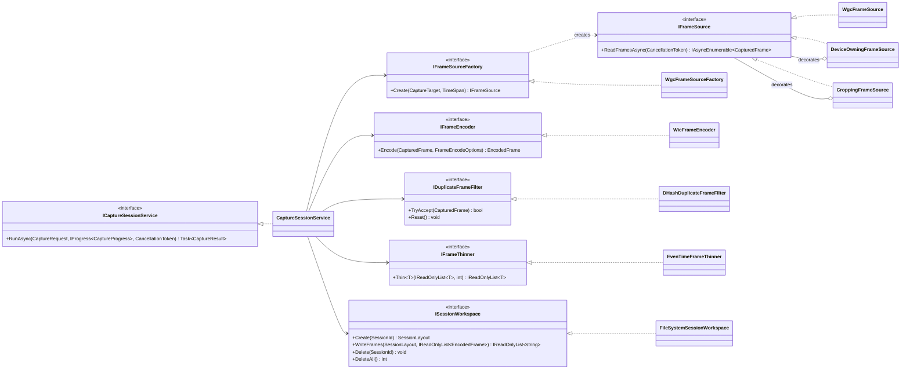
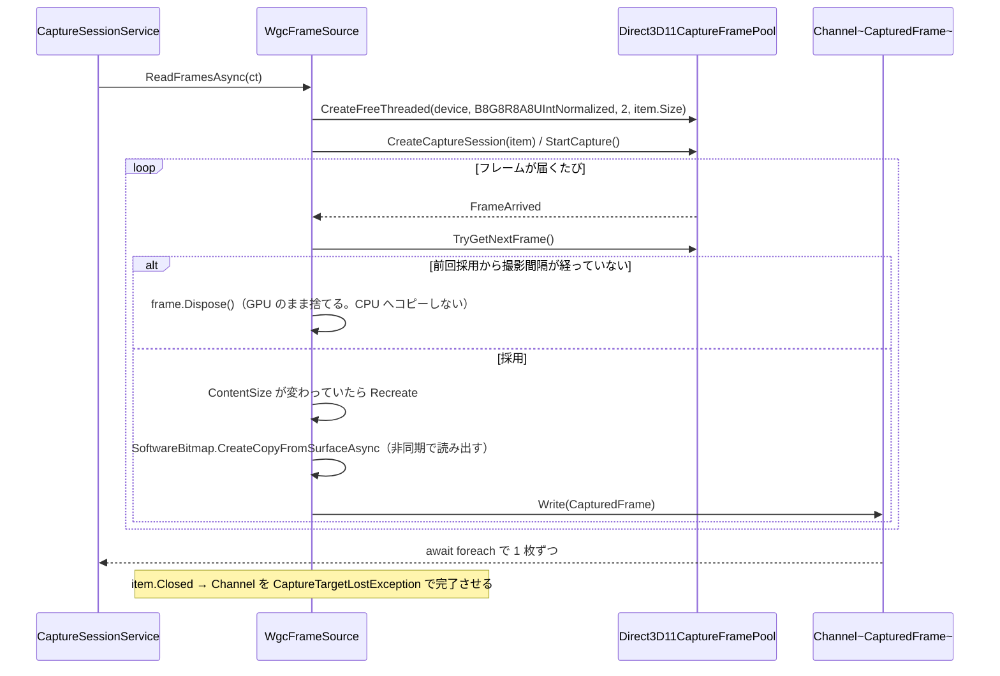

# 詳細設計書（段階 1：キャプチャ）

- 版：0.2（実装後の姿に合わせて更新）
- 最終更新：2026-11-13
- 対応要件：F-01〜F-07
- 前提：`docs/design/01-overview.md`、ADR-0001〜0005 / 0008 / 0010
- **この文書は設計の変更と同じ作業の中で更新する**

---

## 1. この段階の範囲

| ID | 要件 | 実現箇所 |
|---|---|---|
| F-01 | 対象をウィンドウ単位／画面の矩形で選べる。WGC を使う | `WindowCaptureTargetProvider` / `MonitorCaptureTargetProvider` / `GraphicsCaptureItemFactory` / `CroppingFrameSource` |
| F-02 | 撮影間隔を秒で指定（0.5〜10、既定 2） | `CaptureSettings.IntervalSeconds` / `WgcFrameSource` |
| F-03 | 撮影時間を指定（既定 60 秒）。手動停止も可 | `CaptureSettings.DurationSeconds` / `CaptureSessionService` |
| F-04 | グローバルホットキー | **段階 4**（この段階では UI のボタンのみ） |
| F-05 | 知覚ハッシュでほぼ同じフレームを除く。しきい値を設定可 | `DHash` / `DHashDuplicateFrameFilter` |
| F-06 | 長辺 1280px 程度へ縮小（設定可）。上限枚数（既定 20）を超えたら時間的に均等に間引く | `WicFrameEncoder` / `EvenTimeFrameThinner` |
| F-07 | 撮影ごとに一時作業フォルダを作る | `SessionLayout` / `FileSystemSessionWorkspace` |

---

## 2. クラス図



実装の置き場（ADR-0002 決定 2：**外界に触るものだけ Capture**）:

| クラス | 置き場 | 理由 |
|---|---|---|
| `WgcFrameSourceFactory` / `WgcFrameSource` / `DeviceOwningFrameSource` / `WicFrameEncoder` | `NutLens.Capture` | WinRT / Win32 / WIC に触る |
| **`CroppingFrameSource`** | **`NutLens.Core`** | 画素の並べ替えだけ。Windows に依存しないので Core に置き、単体テストの対象にする |
| それ以外 | `NutLens.Core` | 純ロジック |

フレーム源は 3 枚の入れ子になる。

```
WgcFrameSource ──包む── DeviceOwningFrameSource ──（矩形指定時のみ）包む── CroppingFrameSource
```

`DeviceOwningFrameSource` を挟むのは、Direct3D デバイスの寿命をフレーム源に結びつけるため。
フレーム源にデバイスの所有権を持たせると「誰が作って誰が壊すか」が曖昧になる。

---

## 3. 値オブジェクト（`NutLens.Core`）

```csharp
namespace NutLens.Core.Imaging;

/// 撮影直後の生フレーム。BGRA32。
public sealed record CapturedFrame(
    byte[] Bgra,
    int Width,
    int Height,
    int Stride,
    TimeSpan Elapsed) : ITimestamped;

/// 縮小・符号化後のフレーム。
public sealed record EncodedFrame(
    byte[] Bytes,
    int Width,
    int Height,
    TimeSpan Elapsed,
    string FileExtension) : ITimestamped;

public sealed record FrameEncodeOptions(int MaxLongEdgePixels, int JpegQuality);

/// 間引きの対象になれることを表す。
public interface ITimestamped
{
    TimeSpan Elapsed { get; }
}
```

```csharp
namespace NutLens.Core.Capture;

public enum CaptureTargetKind { Window, Monitor }

public readonly record struct PixelRect(int X, int Y, int Width, int Height)
{
    public bool IsEmpty => this.Width <= 0 || this.Height <= 0;
}

/// 撮影対象。CropRegion は Monitor のときだけ意味を持つ（ADR-0003 決定 2）。
public sealed record CaptureTarget(
    CaptureTargetKind Kind,
    nint Handle,
    string Title,
    PixelRect? CropRegion = null);

public sealed record CaptureRequest(CaptureTarget Target, CaptureSettings Settings);

public sealed record CaptureProgress(
    int ReceivedFrames,
    int AcceptedFrames,
    TimeSpan Elapsed);

public sealed record CaptureResult(
    SessionId SessionId,
    string SessionDirectory,
    IReadOnlyList<string> FrameFiles,
    int ReceivedFrames,
    int AcceptedFrames,
    TimeSpan Duration);
```

`Elapsed` はすべて**撮影開始からの経過時間**（2 章の前提）。動画の再生位置ではない。

---

## 4. dHash（F-05 / ADR-0004）

### 4.1 アルゴリズム

```
入力: BGRA バイト列 (width × height, stride)
1. 25 × 24 の格子に分け、各区画の平均輝度を求める（ボックス平均）
   区画 (gx, gy) の範囲:
       x0 = width  * gx / 25      x1 = width  * (gx + 1) / 25
       y0 = height * gy / 24      y1 = height * (gy + 1) / 24
   ただし x1 <= x0 のときは x1 = x0 + 1（高さも同様）。width/height が 25/24 未満でも破綻しない
   輝度 = (R * 299 + G * 587 + B * 114) / 1000     （BGRA 並び：[0]=B [1]=G [2]=R [3]=A）
2. 各行で横に隣り合う区画を比べる
   bit(gy, gx) = cell[gy][gx] > cell[gy][gx + 1]    (gx = 0..23)
3. 576 bit を ulong 9 語に詰める
```

**ボックス平均（区画内の全画素の平均）を使う。最近傍の間引きは使わない。**
最近傍だと動画の圧縮ノイズを拾った 1 画素でビットが反転し、同じ場面でもハッシュが安定しない。

距離は語ごとの `BitOperations.PopCount(a ^ b)` の合計（`PerceptualHash.DistanceTo`）。

**格子をこの細かさにした理由（ADR-0015）。**
実物のフリップ動画をブラウザの窓ごと撮ると、画面の大半が動かない部分
（タブ・サイドバー・動画自体の固定テロップ）で占められる。
9 × 8（64 bit）では動く部分に割り当たるマス目が数個しかなく、
**別々の場面でも距離が 2〜7 しか出ず、既定のしきい値 5 で 14 場面が 6 枚に潰れた。**
25 × 24（576 bit）にすると同じ 14 枚で最小距離 23 になり、既定の 12 で 14 枚すべてが残る。

### 4.2 公開 API

```csharp
namespace NutLens.Core.Hashing;

/// 576 bit の値。ulong の生値を持ち回すと、ビット数が変わったとき呼び出し側が静かに壊れる。
public readonly struct PerceptualHash : IEquatable<PerceptualHash>
{
    public ReadOnlySpan<ulong> Words { get; }
    public int DistanceTo(PerceptualHash other);   // ビット数が違えば例外
    public override string ToString();              // 16 進（ログと確認ツール用）
}

public static class DHash
{
    public const int GridWidth = 25;
    public const int GridHeight = 24;
    public const int BitCount = 576;
    public const int WordCount = 9;

    public static PerceptualHash Compute(CapturedFrame frame);
    public static PerceptualHash Compute(ReadOnlySpan<byte> bgra, int width, int height, int stride);
    public static PerceptualHash FromWords(ReadOnlySpan<ulong> words);
}

public interface IDuplicateFrameFilter
{
    int Threshold { get; }
    int AcceptedCount { get; }
    bool TryAccept(CapturedFrame frame);
    void Reset();
}

/// 撮影ごとに作り直すための窓口。
/// フィルタは受理済みハッシュを持つので、使い回すと前回の撮影の記録が残る。
public interface IDuplicateFrameFilterFactory
{
    IDuplicateFrameFilter Create(int threshold);
}

public sealed class DHashDuplicateFrameFilter : IDuplicateFrameFilter
{
    public const int MinThreshold = 0;
    public const int MaxThreshold = 64;      // 576 bit のうち 64 bit まで
    public const int DefaultThreshold = 12;
    public DHashDuplicateFrameFilter(int threshold);
}

public sealed class DHashDuplicateFrameFilterFactory : IDuplicateFrameFilterFactory;
```

### 4.4 既定しきい値 12 の根拠（実測）

実物のフリップ動画 1 本（YouTube Shorts、ブラウザの窓ごと 2 秒間隔）を 2 回撮って測った。
30 秒（14 枚）と 68 秒（35 枚）。**どちらもしきい値 12 で全部が残った。**

| 測った境界 | 値 | 中身 |
|---|---|---|
| ノイズ（同じ画像を 1/2 に縮小） | **5** | ハッシュの揺らぎの下限 |
| **既定のしきい値** | **12** | — |
| 同じショットの続き（2 秒差、字幕だけ違う） | 16 | 落としてよい |
| 別の場面どうしの最小（62 秒差、顔のアップ ↔ 料金所） | **18** | **落としてはいけない** |

**「同じショットの続き」と「全く別の場面」の間が 2 ビットしかない。**
しきい値を上げて重複をもっと削ろうとすると、別の場面を落とし始める。

したがって**重複除去に「似たショットをまとめる」仕事を負わせない。**
全部残して、枚数は間引き（§5、上限 20 枚）で絞るのが正しい分担。

### 4.5 ループ再生の重複は一部しか落ちない（実測。仕様として受け入れる）

同じ動画を 130 秒撮って、ループで戻ってきた場面を測った（周期は実測 114.4 秒）。

| ループで戻ってきた組 | 距離 | しきい値 12 で落ちるか |
|---|---|---|
| frame_006 ↔ frame_063 | 3 | 落ちる |
| frame_003 ↔ frame_060 | 11 | 落ちる |
| frame_007 ↔ frame_064 | 11 | 落ちる |
| frame_008 ↔ frame_065 | **19** | **落ちない** |

**撮影間隔（2 秒）とループ周期が同期していない**ため、2 周目は少しずれた瞬間に当たる。
動きの速いショットでは、そのずれが 19 ビットの差になる。

そして**別の場面どうしも 15〜19 の帯にいる**ので、しきい値を上げて取りこぼしを拾うと
別の場面を失う。

```
しきい値 12 : 65 枚 → 62 枚（繰り返しを 3 つ落とし、別の場面は 0）
しきい値 18 : 65 枚 → 58 枚（繰り返し 3 つ＋別の場面 4 つ）
```

**残った重複は枚数の間引き（§5、上限 20 枚）で吸収する。**
重複除去にそこまでの仕事を負わせない。

**残っている不確かさ**（ADR-0015 宿題）:

- **長く撮るほど「別の場面どうしの最小距離」が下がる**（14 枚で 23、35 枚で 18、65 枚で 15）。
  下がり続けるが、しきい値 12 を下回る組は 65 枚でも出ていない
- ノイズの目安に使った「縮小によるずれ」には再生中の揺らぎや圧縮ノイズが含まれない。
  **実際のノイズはこれより大きい**
- 測定は動画 1 本のみ。別の作りのフリップ動画では測っていない

測り直すときは `tools/NutLens.CaptureProbe` を使う（§12.1）。

### 4.3 判定の規則

- 新しいハッシュを**受理済みハッシュ全件**と比べ、**最小距離 ≤ しきい値なら棄却**（ADR-0004 決定 2）
- しきい値の既定は 5、範囲は 0〜16
- **フィルタは 1 回の撮影ごとに作り直すか `Reset()` する。**
  使い回すと前回の撮影のハッシュが残り、別の動画のフレームが落ちる

---

## 5. 間引き（F-06 / `EvenTimeFrameThinner`）

### 5.1 アルゴリズム

```
Thin(frames, maxCount):
  maxCount <= 0            → ArgumentOutOfRangeException
  frames.Count <= maxCount → frames をそのまま返す
  maxCount == 1            → [frames[0]]

  t0 = frames[0].Elapsed, t1 = frames[^1].Elapsed, span = t1 - t0

  // (1) 等間隔の目標時刻ごとに最近傍を選ぶ
  selected = SortedSet<int>()
  for k = 0 .. maxCount - 1:
      target = t0 + span * k / (maxCount - 1)
      selected.Add(NearestIndex(frames, target))      // 二分探索

  // (2) 目標が重複して足りない分を補充する
  while selected.Count < maxCount:
      // 未選択のうち、選択済みとの時間差が最大のものを足す
      best = argmax_{i 未選択} min(|t_i - 直前の選択済み|, |t_i - 直後の選択済み|)
      selected.Add(best)

  return selected を昇順に並べたフレーム列
```

- `frames` は `Elapsed` の**昇順に整列済み**であることを前提とする（撮影順に積むので常に成立）
- **最初と最後は必ず残る**（k=0 と k=maxCount-1 の目標がちょうど t0 と t1）
- `span` が 0（全フレームが同時刻）でも破綻せず、`maxCount` 件を返す
- 計算量は最悪 O(n × maxCount)。n ≤ 200、maxCount ≤ 20 なので無視できる

### 5.2 公開 API

```csharp
namespace NutLens.Core.Sampling;

public interface IFrameThinner
{
    IReadOnlyList<T> Thin<T>(IReadOnlyList<T> frames, int maxCount) where T : ITimestamped;
}

public sealed class EvenTimeFrameThinner : IFrameThinner;
```

---

## 6. セッションと作業フォルダ（F-07 / 5.5）

### 6.1 パス

```csharp
namespace NutLens.Core.Sessions;

/// セッション ID。Claude Code の --session-id と同じ値になる（ADR-0007）。
public readonly record struct SessionId(Guid Value)
{
    public static SessionId New() => new(Guid.NewGuid());
    public override string ToString() => this.Value.ToString("D");
    public static bool TryParse(string? text, out SessionId id);
}

public interface IAppDataPaths
{
    string Root { get; }          // %LOCALAPPDATA%\NutLens
    string WorkRoot { get; }      //   \work
    string HistoryRoot { get; }   //   \history
    string SettingsFile { get; }  //   \settings.json
}

public sealed class SessionLayout
{
    public SessionLayout(string workRoot, SessionId id);

    public SessionId Id { get; }
    public string Root { get; }               // <workRoot>\<id>
    public string FramesDirectory { get; }    //   \frames
    public string AudioFile { get; }          //   \audio.wav          段階 3
    public string TranscriptFile { get; }     //   \transcript.txt     段階 3
    public string OcrFile { get; }            //   \ocr.txt            段階 3
    public string WebDetectionFile { get; }   //   \web_detection.json 段階 3'
    public string PromptFile { get; }         //   \prompt.md          段階 2
    public string ClaudeLogFile { get; }      //   \claude.log         段階 2

    /// 例: frame_001_t0002.0s.jpg
    public static string FrameFileName(int index, TimeSpan elapsed, string extension);
}
```

ファイル名の書式は `$"frame_{index:D3}_t{elapsed.TotalSeconds:0000.0}s{extension}"`。
**経過秒がファイル名から読めること**が、段階 2 のプロンプト生成（F-21「フレームの相対パス一覧と撮影時刻」）で効く。

### 6.2 作業フォルダの操作

```csharp
public interface ISessionWorkspace
{
    SessionLayout Create(SessionId id);
    IReadOnlyList<string> WriteFrames(SessionLayout layout, IReadOnlyList<EncodedFrame> frames);
    bool Exists(SessionId id);
    void Delete(SessionId id);
    /// work\ の全子フォルダを消す。消した数を返す。
    int DeleteAll();
}

public sealed class FileSystemSessionWorkspace : ISessionWorkspace
{
    public FileSystemSessionWorkspace(IAppDataPaths paths);
}
```

削除の呼び出し箇所（5.5）:

| タイミング | 呼ぶもの | 段階 |
|---|---|---|
| アプリ起動時（異常終了の残骸回収） | `DeleteAll()` | 1 |
| 次の撮影を始めたとき | `DeleteAll()` → `Create()` | 1 |
| 結果画面を閉じたとき | `Delete(id)` | 2 |
| アプリ終了時 | `DeleteAll()` | 1 |

`KeepTemporaryData`（既定 **false**）が true のときは削除しない。
**既定が false であることが 5.5 の達成に必要**なので、設定画面では既定を変えた状態が分かるように表示する。

---

## 7. 設定（`settings.json`）

```csharp
namespace NutLens.Core.Settings;

public sealed record CaptureSettings
{
    public double IntervalSeconds { get; init; } = 2.0;   // F-02  0.5 〜 10
    public double DurationSeconds { get; init; } = 60.0;  // F-03  1 〜 3600
    public int DuplicateThreshold { get; init; } = 12;    // F-05  0 〜 64（576 bit 中）
    public int MaxFrames { get; init; } = 20;             // F-06  1 〜 100
    public int MaxLongEdgePixels { get; init; } = 1280;   // F-06  320 〜 4096
    public int JpegQuality { get; init; } = 85;           //       30 〜 100
    public int MaxFramesInMemory { get; init; } = 200;    // ADR-0005  20 〜 2000
    public bool CaptureCursor { get; init; } = false;
    public CaptureSettings Normalize();                   // 範囲外を丸める
}

public sealed record ClaudeSettings          // 器だけ。使うのは段階 2
{
    public string? ExecutablePath { get; init; }
    public int MaxTurns { get; init; } = 30;              // ADR-0006 決定 5
}

public sealed record NutLensSettings
{
    public const int CurrentVersion = 2;                  // ADR-0015 でしきい値の意味が変わった
    public int Version { get; init; } = CurrentVersion;
    public string UiLanguage { get; init; } = "ja";       // D-09
    public bool KeepTemporaryData { get; init; } = false; // 5.5
    public CaptureSettings Capture { get; init; } = new();
    public ClaudeSettings Claude { get; init; } = new();

    /// 古い版の設定を今の版に直す。読み込み時にだけ呼ぶ（保存時に呼ぶと二重にかかる）。
    /// 版 1 の duplicateThreshold は 64 bit 中の値なので、既定値へ戻す（ADR-0015 決定 4）。
    public NutLensSettings Migrate();

    public NutLensSettings Normalize();
}
```

### 7.1 保存

```csharp
public interface ISettingsStore
{
    NutLensSettings Load();
    void Save(NutLensSettings settings);
}

public sealed class JsonSettingsStore : ISettingsStore
{
    public JsonSettingsStore(IAppDataPaths paths);
}
```

- `System.Text.Json` の**ソース生成**（`JsonSerializerContext`）を使う。
  リフレクションに頼らないので、段階 5 のトリミング／AOT 化の選択肢が残る
- **ソース生成で逆直列化すると、JSON に無い入れ子オブジェクトのプロパティ初期化子が効かず `null` が入る。**
  リフレクション経路では初期化子が効くので、挙動が違う（実装中に実際に踏んだ）。
  受け止めないと、落ちるのは設定を読んだ瞬間＝アプリの起動時になる。
  `NutLensSettings.Normalize()` で `Capture` / `Claude` の `null` を既定値に差し替えている。
  回帰テスト：`SettingsTests.入れ子の設定が書かれていなくても既定値で読める`
- **保存はアトミックに行う**：`settings.json.tmp` へ書き、`File.Move(tmp, settings.json, overwrite: true)` で置換。
  **直接上書きすると、書き込み中にプロセスが落ちたとき設定ファイルが壊れる**
- 読み込みに失敗したら、壊れたファイルを `settings.json.broken` に退避し、既定値で続行する（概要設計 10.1）

---

## 8. 撮影の取り仕切り（`CaptureSessionService`）

```csharp
namespace NutLens.Core.Capture;

public interface ICaptureSessionService
{
    Task<CaptureResult> RunAsync(
        CaptureRequest request,
        IProgress<CaptureProgress>? progress,
        CancellationToken cancellationToken);
}

public sealed class CaptureSessionService : ICaptureSessionService
{
    public CaptureSessionService(
        IFrameSourceFactory frameSourceFactory,
        IFrameEncoder encoder,
        IFrameThinner thinner,
        ISessionWorkspace workspace,
        IDuplicateFrameFilterFactory filterFactory,   // しきい値を渡して毎回作る
        TimeProvider timeProvider);
}
```

### 8.1 処理の流れ

```
1. settings.Normalize()
2. workspace.DeleteAll()                      ← 次の撮影を始めたときの削除（5.5）
3. sessionId = SessionId.New(); layout = workspace.Create(sessionId)
4. filter = filterFactory.Create(settings.DuplicateThreshold)
5. source = frameSourceFactory.Create(target, 撮影間隔)
6. 安全網の CTS を作る：CancellationTokenSource(撮影時間 + 5 秒, timeProvider) と
   呼び出し元の token をリンクする
7. await foreach (CapturedFrame frame in source.ReadFramesAsync(linked.Token)):
       received++
       if (frame.Elapsed >= 撮影時間) break          ← 撮影時間による終了（F-03）
       if (!filter.TryAccept(frame)) { progress 通知; continue; }
       encoded.Add(encoder.Encode(frame, new FrameEncodeOptions(長辺, 品質)))
       if (encoded.Count > MaxFramesInMemory)
           encoded = thinner.Thin(encoded, MaxFramesInMemory / 2)   ← ADR-0005 決定 3
       progress 通知
8. OperationCanceledException は「手動停止」として正常終了に倒す（F-03）
9. await source.DisposeAsync()
10. kept = thinner.Thin(encoded, settings.MaxFrames)
11. files = workspace.WriteFrames(layout, kept)     ← ここで初めてディスクに書く
12. return CaptureResult(...)
```

**終了の条件は 3 つ**：撮影時間に達した（手順 7）／手動停止（`CancellationToken`）／
フレーム源が尽きた（対象が閉じられた等）。

**手順 6 の安全網がないと、フレームが 1 枚も届かない対象（更新されないウィンドウ）で永久に待つ。**
安全網が先に発火した場合も、それまでに採れた分で結果を返す。

### 8.2 時間の扱い

経過時間の判定は**フレーム自身の `Elapsed`** を使い、壁時計は使わない。
これにより、偽の `IFrameSource` を差し込んだテストが時刻に依存せず決定的に動く。
`TimeProvider` は安全網の CTS にだけ使う。

### 8.3 例外

| 状況 | 例外 |
|---|---|
| 対象が閉じられた | `CaptureTargetLostException`（`IFrameSource` が投げる） |
| D3D デバイスの作成に失敗・ロスト | `CaptureDeviceException` |
| WGC が使えない環境 | `CaptureUnavailableException` |

```csharp
namespace NutLens.Core.Diagnostics;

public abstract class NutLensException : Exception;
public sealed class CaptureTargetLostException : NutLensException;
public sealed class CaptureDeviceException : NutLensException;
public sealed class CaptureUnavailableException : NutLensException;
public sealed class SettingsCorruptedException : NutLensException;
```

---

## 9. WGC によるフレーム取得（`NutLens.Capture`）

### 9.0 Direct3D 11 に触る範囲（実装後の姿）

`Direct3D11CaptureFramePool` が `IDirect3DDevice` を要求するので、D3D11 デバイスは必要になる。
だが**触るのはデバイスを 1 つ作るところだけ**で、テクスチャの確保も `Map`/`Unmap` も書かない。

| 工程 | 使うもの |
|---|---|
| D3D11 デバイスの作成 | CsWin32 が生成した `PInvoke.D3D11CreateDevice`（`BGRA_SUPPORT` 必須。付け忘れるとフレームプールの作成がそれらしい理由なく失敗する） |
| 失敗時の退避 | `D3D_DRIVER_TYPE_HARDWARE` → だめなら `WARP` |
| WinRT デバイス化 | `d3d11.dll` の `CreateDirect3D11DeviceFromDXGIDevice`（`LibraryImport` で手書き） |
| GPU → CPU の画素取り出し | **`SoftwareBitmap.CreateCopyFromSurfaceAsync`** → `CopyToBuffer` → `DataReader.FromBuffer` |

この構成により **Vortice などの追加依存はゼロ**（ADR-0003 実装で分かったこと 1）。

### 9.1 COM 相互運用（`dynamic` を使わない。ADR-0010 決定 5）

```csharp
[ComImport]
[Guid("3628E81B-3CAC-4C60-B7F4-23CE0E0C3356")]
[InterfaceType(ComInterfaceType.InterfaceIsIUnknown)]
internal interface IGraphicsCaptureItemInterop
{
    nint CreateForWindow(nint window, in Guid iid);
    nint CreateForMonitor(nint monitor, in Guid iid);
}

[ComImport]
[Guid("A9B3D012-3DF2-4EE3-B8D1-8695F457D3C1")]
[InterfaceType(ComInterfaceType.InterfaceIsIUnknown)]
internal interface IDirect3DDxgiInterfaceAccess
{
    nint GetInterface(in Guid iid);
}
```

- アクティベーションファクトリは `combase.dll` の `RoGetActivationFactory` を直に呼ぶ
  （`WindowsCreateString` / `WindowsDeleteString` も同様）
- 返ってきた ABI ポインタは `WinRT.MarshalInspectable<GraphicsCaptureItem>.FromAbi(ptr)` で射影型にする
- `d3d11.dll` の `CreateDirect3D11DeviceFromDXGIDevice` で `IDirect3DDevice` を作る

### 9.2 `WgcFrameSource` の動作



**読み出しは同時に 1 本だけに制限する。**
`CreateCopyFromSurfaceAsync` は非同期なので、`FrameArrived` の中で待たずに投げると
前の読み出しが終わる前に次が始まる。`SemaphoreSlim.Wait(0)` で入れなかったフレームは見送る。
ハンドラ内で待つと、以後のフレーム配信そのものが遅れる。

- `Channel.CreateBounded(capacity: 4, FullMode = DropOldest)`。
  **消費側（符号化）が詰まってもフレームを溜め込まず、古いものから捨てる。**
  溜め込むとメモリが膨らみ、UI の応答性も落ちる
- `IsCursorCaptureEnabled = settings.CaptureCursor`（既定 false）
- `IsBorderRequired = false` は **`OperatingSystem.IsWindowsVersionAtLeast(10, 0, 22000)`** で囲う。
  **確認を飛ばすと Windows 10 で撮影開始の瞬間に落ちる**（ADR-0003 決定 3）。
  `ApiInformation` ではなく `OperatingSystem` を使うのは、プラットフォーム互換性の解析器
  （CA1416）がこちらしか理解せず、`TreatWarningsAsErrors` でビルドが通らなくなるため
- `GraphicsCaptureSession.IsSupported()` が false なら `CaptureUnavailableException`

### 9.3 `CroppingFrameSource`（矩形。ADR-0003 決定 2）

**置き場は `NutLens.Core.Capture`。** 画素の並べ替えだけで Windows に依存しないため。

`IFrameSource` を包むデコレータ。各 `CapturedFrame` の BGRA を行単位でコピーして切り出す。
矩形はフレーム寸法でクランプする（モニタの解像度が変わった場合に範囲外にならないように）。
矩形がフレーム全体と一致する場合は、元のフレームをそのまま返す（無駄なコピーをしない）。

矩形の指定は `OverlayRegionSelector`（App 側）が行う。
全画面オーバーレイで得た仮想デスクトップ座標を、乗っているモニタを判定して**モニタ相対**に直す。
WGC はモニタ単位でしか取れないので、仮想デスクトップ座標のままでは使えない。

### 9.4 対象の列挙

| クラス | 使う Win32 API | 除外するもの |
|---|---|---|
| `WindowCaptureTargetProvider` | `EnumWindows` / `IsWindowVisible` / `GetWindowTextLength` / `DwmGetWindowAttribute(DWMWA_CLOAKED)` / `GetWindowLong(GWL_EXSTYLE)` | タイトルが空・不可視・**DWM に cloaked とされたもの**（UWP の幽霊ウィンドウ）・`WS_EX_TOOLWINDOW`・自分自身のウィンドウ |
| `MonitorCaptureTargetProvider` | `EnumDisplayMonitors` / `GetMonitorInfo` | なし（全モニタを出す） |

P/Invoke は `Microsoft.Windows.CsWin32`（`NativeMethods.txt` に API 名を列挙）で生成する。手書きしない。

---

## 10. 符号化（`WicFrameEncoder` / F-06 / ADR-0008）

```
1. BitmapSource.Create(width, height, 96, 96, PixelFormats.Bgra32, null, bgra, stride)
2. 長辺 > MaxLongEdgePixels なら ratio = MaxLongEdgePixels / 長辺 で TransformedBitmap
   （長辺が既に上限以下なら拡大しない）
3. JpegBitmapEncoder { QualityLevel = JpegQuality } で MemoryStream へ
4. EncodedFrame(bytes, 幅, 高さ, Elapsed, ".jpg")
```

**生成した `BitmapSource` / `TransformedBitmap` / `BitmapFrame` はすべて `Freeze()` する。**
符号化はバックグラウンドスレッドで走るため、凍結しないと
UI スレッド以外から触った時点で `InvalidOperationException` になる（ADR-0008 決定 4）。

---

## 11. 画面（段階 1）

### 11.1 メインウィンドウ

| 要素 | 内容 |
|---|---|
| 対象の種類 | ラジオ：ウィンドウ / モニタ全体 / **画面の一部** |
| 対象の一覧 | コンボボックス（更新ボタン付き） |
| **キャプチャ範囲を選択する…** | ボタン → 全画面オーバーレイでドラッグ。**画面の文言は「矩形」を使わない**（2026-11-14。利用者から分かりにくいとの指摘）。設計書の中では引き続き「矩形」と書く（実装上の用語） |
| 撮影間隔 | 数値入力（0.5〜10 秒、既定 2） |
| 撮影時間 | 数値入力（1〜3600 秒、既定 60） |
| 重複しきい値 | 数値入力（0〜64、既定 12） |
| 最大枚数 | 数値入力（1〜100、既定 20） |
| 長辺 px | 数値入力（320〜4096、既定 1280） |
| 開始 / 停止 | ボタン |
| 進捗 | 「経過 12.0 秒 / 受信 240 枚 / 採用 8 枚」＋プログレスバー |
| 結果 | 保存枚数とフォルダを開くボタン |

**「受信」と「採用」を両方出す。** 重複除去が効くと採用枚数が途中から増えなくなるため、
採用枚数だけだと止まって見える（ADR-0004 の影響）。

### 11.2 矩形選択オーバーレイ

全モニタを覆う `WindowStyle=None` / `AllowsTransparency=true` / `Topmost=true` の窓。
ドラッグで矩形を描き、確定時に**どのモニタ上か**を判定して
`CaptureTarget(Monitor, hMonitor, 名前, モニタ相対の PixelRect)` を作る。
`Esc` で取り消し。

### 11.3 文字列リソース（D-09）

`NutLens.App/Resources/Strings.resx`（日本語＝既定の中立リソース）。
英語を足すときは `Strings.en.resx` を置くだけでよい。

アクセス用のクラス `Resources/Strings.cs` は**手で書いている**。
`ResXFileCodeGenerator` による自動生成は Visual Studio でしか走らず、
`dotnet build` だけでビルドできる状態を保ちたいため。
XAML からは `{x:Static res:Strings.AppTitle}` で参照する。

**XAML に日本語を直接書かない。** 段階 1 から徹底する（後から全部を剥がすのは高くつく）。

### 11.4 DPI（矩形選択）

`app.manifest` で `PerMonitorV2` を宣言し、DPI 仮想化を切っている。
切らないと、高 DPI 環境で「選んだ矩形」と「実際に切り出される範囲」がずれる。
オーバーレイ側では WPF の論理単位を
`PresentationSource.CompositionTarget.TransformToDevice` で物理画素に直す。

---

## 12. テスト（`NutLens.Core.Tests`）

| テストクラス | 確かめること |
|---|---|
| `DHashTests` | ビット数が 576／指定したビット列どおりのハッシュになる／同じ画像で同じハッシュ／全体の明度を一律に変えても同一／別画像で距離が大きい／幅高さが 25・24 未満でも落ちない／距離の対称性／**語をまたぐビット反転（65・200 ビット）でも距離が合う**／ビット数の違うハッシュは比較できない |
| `DuplicateFrameFilterTests` | **ループ再生（A,B,C,A,B,C）で 3 枚だけ残る**／しきい値ちょうどで棄却・1 つ離れると採用／しきい値 0 で 1 ビット差も通る／既定値が 12／`Reset()` で状態が消える／しきい値の範囲外は例外 |
| `SettingsTests`（移行） | 版 1 の `duplicateThreshold` が既定値に戻る／**しきい値以外の設定は保たれる**／版 2 の値はそのまま |
| `EvenTimeFrameThinnerTests` | `n ≤ max` は素通し／`n > max` で件数＝max／**最初と最後を含む**／間隔がほぼ均等／`max = 1`／全フレームが同時刻でも max 件返す／`max ≤ 0` は例外 |
| `JsonSettingsStoreTests` | ラウンドトリップ／壊れた JSON で既定値＋`.broken` への退避／範囲外の値が `Normalize()` で丸まる／保存がアトミック |
| `SessionLayoutTests` | パスの組み立て／`FrameFileName` の書式（`frame_001_t0002.0s.jpg`） |
| `FileSystemSessionWorkspaceTests` | 作成・書き出し・`Delete`・`DeleteAll`／存在しない ID の削除で落ちない |
| `CaptureSessionServiceTests` | 撮影時間で止まる／手動停止（キャンセル）で**それまでの分を返す**／重複除去と間引きが連携する／メモリ上限を超えたらその場で間引く／フレーム 0 枚でも結果を返す／`DeleteAll` が撮影開始時に呼ばれる／フレーム源が必ず破棄される |
| `CroppingFrameSourceTests` | 矩形の寸法と画素が元と一致する／全体と同じ矩形なら元をそのまま返す／画面より大きい矩形・負座標でクランプされる／包んだフレーム源へ委譲・破棄される |

偽物は手書きのスタブクラス（モックライブラリを足さない）。
`FakeFrameSource` は与えられた `CapturedFrame` の列をそのまま返し、
`FakeFrameEncoder` は BGRA をそのまま `EncodedFrame` に詰め替える。

テスト用の画像は `FrameFactory.PatternFromHash(bits)` が作る。
**dHash がちょうど指定の 64 bit になる画像**を生成するので、
「距離がちょうど 5 のフレーム」のような境界値を正確に書ける。
dHash は 9 × 8 の区画の平均輝度しか見ないため、区画を単色で塗れば平均が確定する。

現状：**140 件すべて成功**（段階 2 のぶんを含む）。

### 12.1 実機での確認ツール

`tools/NutLens.CaptureProbe` は、GUI を手で操作せずにキャプチャ経路を通して結果を出す。
製品には含めない。

```powershell
# モニタ 1 を 8 秒・間隔 1 秒・上限 5 枚で撮る
dotnet run --project tools/NutLens.CaptureProbe -- 8 1 5

# 1 秒ごとに中身が変わる窓を自分で出して、それを撮る（しきい値 0・一時データを残す）
dotnet run --project tools/NutLens.CaptureProbe -- 12 1 8 0 --animate --keep
```

引数は `[秒数] [間隔秒] [最大枚数] [しきい値]`。

保存済みのフレームを後から測る入口もある（ADR-0004 / ADR-0015 はこれで測った）。

```powershell
# dHash の距離・総当たり・しきい値ごとの採用枚数
dotnet run --project tools/NutLens.CaptureProbe -- --hashes "<frames フォルダ>"

# 動画の部分だけを切り出して同じことを測る（引数は X Y 幅 高さ）
dotnet run --project tools/NutLens.CaptureProbe -- 492 92 344 620 --hashes "<frames フォルダ>"

# 縮小でハッシュがどれだけ動くか（ノイズの目安）
dotnet run --project tools/NutLens.CaptureProbe -- --scale-sensitivity "<frames フォルダ>"

# 格子の細かさを変えたときの分離具合（ADR-0015 の根拠）
dotnet run --project tools/NutLens.CaptureProbe -- --grid "<frames フォルダ>"
```

**重複しきい値を決め直すときはこれで測る（推測で決めない）。**

---

## 13. この段階でやらないこと

| 項目 | 段階 |
|---|---|
| グローバルホットキー（F-04） | 4 |
| タスクトレイ常駐 | 4 |
| 設定画面（UI） | 4。段階 1 ではメインウィンドウの入力欄が直接 `CaptureSettings` を編集する |
| 音声・文字起こし・OCR | 3 |
| プロンプト生成・`claude -p` 起動・結果表示 | 2 |
| 履歴 | 4 |
