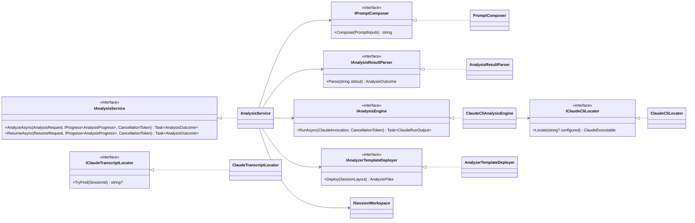
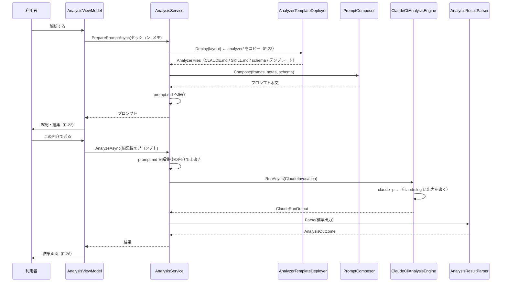

# 詳細設計書（段階 2：Claude Code 連携）

- 版：0.2（実装後の姿に合わせて更新）
- 最終更新：2026-11-13
- 対応要件：F-21〜F-27、5.4、7 章（analyzer/）
- 前提：`docs/design/01-overview.md`、ADR-0006 / 0007 / 0011 / 0012 / 0013 / 0014
- **この文書は設計の変更と同じ作業の中で更新する**

---

## 1. この段階の範囲

| ID | 要件 | 実現箇所 |
|---|---|---|
| F-21 | テンプレートからプロンプトを自動生成（外部ファイル） | `PromptComposer` / `analyzer/prompt-template.md` |
| F-22 | 送る前に確認・編集できる | `PromptReviewWindow` |
| F-23 | `analyzer/` をセッションへコピーし、そこを作業ディレクトリにする | `AnalyzerTemplateDeployer` |
| F-24 | `--output-format json` と `--json-schema` で結果を受けてパース | `ClaudeCliAnalysisEngine` / `AnalysisResultParser` |
| F-25 | 進捗表示とキャンセル（プロセス終了） | `ClaudeCliAnalysisEngine` / `AnalysisViewModel` |
| F-26 | 結果画面（候補・確信度・根拠・未確認点・参考 URL） | `ResultWindow` |
| F-27 | 追加情報を付けて `--resume` で再調査 | `ClaudeCliAnalysisEngine.ResumeAsync` |
| 5.4 | ツールの絞り込み・`--max-turns`・パス検出・`claude.log` | ADR-0006 / `ClaudeCliLocator` |
| 7 章 | analyzer/ 一式 | `analyzer/` |

F-28（履歴）は段階 4。

---

## 2. プロジェクト構成の追加（ADR-0011）

```
NutLens.App  →  NutLens.Capture   →  NutLens.Core
     \       →  NutLens.Analysis  ↗
```

`NutLens.Analysis`（`net10.0`、`-windows` なし）に入るもの:

| クラス | 責務 |
|---|---|
| `ClaudeCliLocator` | `claude` を探して `--version` で確かめる |
| `ClaudeCliAnalysisEngine` | `claude -p` の起動・標準出力の受け取り・`claude.log` の書き出し |
| `AnalyzerTemplateDeployer` | `analyzer/` をセッションフォルダへ複製する |
| `ClaudeTranscriptLocator` | 会話履歴の `.jsonl` を**探す**（組み立てない。ADR-0013 決定 3） |

**`Process.Start` を書いてよいのはこのプロジェクトだけ**（ADR-0011 決定 2）。

抽象とプロンプト生成・結果パースは `NutLens.Core`（純ロジック）。

---

## 3. クラス図



置き場（ADR-0011）:

| 置き場 | クラス |
|---|---|
| `NutLens.Core` | すべての抽象、`PromptComposer`、`AnalysisResultParser`、`AnalysisService`、値オブジェクト |
| `NutLens.Analysis` | `ClaudeCliAnalysisEngine`、`ClaudeCliLocator`、`AnalyzerTemplateDeployer`、`ClaudeTranscriptLocator` |

`AnalysisService`（取り仕切り役）を Core に置けるのは、
`IAnalysisEngine` の背後に外界が隠れているため。偽物を差し込めば `claude` 無しでテストできる。

---

## 4. 値オブジェクト（`NutLens.Core.Analysis`）

```csharp
namespace NutLens.Core.Analysis;

/// 利用者が入力する補助情報（F-13）。段階 2 の時点では URL・投稿者・キャプション・自由メモ。
public sealed record UserNotes(
    string? SourceUrl = null,
    string? AuthorName = null,
    string? Caption = null,
    string? FreeText = null)
{
    public bool IsEmpty { get; }
}

/// プロンプトに差し込む材料。
public sealed record PromptInputs(
    IReadOnlyList<FrameReference> Frames,
    UserNotes Notes,
    string SchemaRelativePath,
    string? Transcript = null,       // 段階 3
    string? OcrText = null,          // 段階 3
    string? WebDetectionJson = null); // 段階 3 の後

/// プロンプトに載せるフレーム 1 枚分。パスは作業ディレクトリからの相対。
public sealed record FrameReference(string RelativePath, TimeSpan Elapsed);

/// claude を 1 回起動するための指示。
public sealed record ClaudeInvocation(
    string WorkingDirectory,
    string Prompt,
    string SchemaJson,
    SessionId SessionId,
    int MaxTurns,
    string LogFilePath,
    bool Resume);

/// claude の生の実行結果。パース前。
public sealed record ClaudeRunOutput(
    int ExitCode,
    string StandardOutput,
    string StandardError,
    TimeSpan Duration);

/// 解析の結果（F-26）。schema/result.schema.json と 1 対 1。
public sealed record MovieCandidate(
    string? TitleJa,
    string? TitleOriginal,
    int? Year,
    string Type,                       // movie | tv | short | unknown
    double Confidence,
    IReadOnlyList<string> Evidence,
    IReadOnlyList<string> Mismatches,
    IReadOnlyList<string> Sources);

public sealed record AnalysisResult(
    IReadOnlyList<MovieCandidate> Candidates,
    IReadOnlyList<string> ObservedFeatures,
    IReadOnlyList<string> UnverifiedPoints,
    IReadOnlyList<string> SearchQueriesUsed);

/// 1 回の解析の顛末。失敗でも生の出力を持ち続ける（ADR-0012 決定 2）。
public sealed record AnalysisOutcome(
    bool Succeeded,
    AnalysisResult? Result,
    AnalysisRunInfo RunInfo,
    string RawOutput,
    string? ErrorMessage);

/// 画面に出す実行の情報（ADR-0012 決定 3）。
public sealed record AnalysisRunInfo(
    SessionId SessionId,
    int Turns,
    decimal? CostUsd,
    string? StopReason,
    int PermissionDenialCount,
    TimeSpan Duration);

public sealed record AnalysisProgress(string Message, TimeSpan Elapsed);
```

---

## 5. プロンプトの生成（F-21 / ADR-0014 決定 4）

### 5.1 テンプレート

`analyzer/prompt-template.md`。差し込みは `{{名前}}` の単純置換のみ。
**未知のプレースホルダは置換せずそのまま残す**（打ち間違いに気づけるように）。

| プレースホルダ | 中身 | 無いとき |
|---|---|---|
| `{{frames}}` | `- frames/frame_001_t0000.0s.jpg （撮影開始から 0.0 秒）` の一覧 | `（フレームなし）` |
| `{{transcript}}` | 文字起こし本文 | `（音声の文字起こしはありません）` |
| `{{ocr}}` | OCR 結果 | `（OCR の結果はありません）` |
| `{{web_detection}}` | Web Detection の参考情報 | `（外部の画像検索は使っていません）` |
| `{{notes}}` | 利用者のメモ | `（メモなし）` |
| `{{schema}}` | `schema/result.schema.json` | — |

### 5.2 公開 API

```csharp
public interface IPromptComposer
{
    string Compose(PromptInputs inputs);
}

public sealed class PromptComposer : IPromptComposer
{
    public PromptComposer(string template);
}
```

テンプレートは読み込み済みの文字列を受け取る。ファイルの読み込みは呼び出し側（Analysis 層）。
これで `PromptComposer` が純ロジックのままになり、テストが書ける。

### 5.3 メモの書き方

空の項目は行ごと出さない。空行や「（未入力）」が並ぶとプロンプトが読みにくくなる。

```
- 動画の URL: https://…
- 投稿者: …
- キャプション: …
- メモ: …
```

---

## 6. `claude -p` の起動（ADR-0006 / 0011 / 0012）

### 6.1 引数

```
claude -p
  --output-format json
  --json-schema <result.schema.json の中身をそのまま>   ← インラインのみ。ファイルパスは不可（実測）
  --tools "Read,WebSearch,WebFetch"
  --allowedTools "Read,WebSearch,WebFetch"
  --permission-prompts none
  --session-id <SessionId>          （初回）
  --resume <SessionId>              （再調査。--session-id の代わり）
  --max-turns <設定値。既定 30>
```

**プロンプト本文は引数に載せない。標準入力から渡す**（ADR-0038）。

```
標準入力 ← <プロンプト本文>  …… 書いたらすぐ閉じる
```

理由は安全性。プロンプトの中身は OCR と文字起こし、つまり
**画面に映っていた任意の文字列**で、こちらが決められない。
npm 版（`claude.cmd`）は `cmd.exe` 経由で起動するが、
**`cmd.exe` は .NET が付ける `\"` をエスケープと解釈しない。**
引用符を含む文字列が引用の外へ抜け、後続の `&` が実行される
（CVE-2024-24576 と同じ形）。あわせて `cmd.exe` の 8191 文字の上限も外れる。

**残りの引数は `ProcessStartInfo.ArgumentList` に積む。** 文字列連結しない
（`--json-schema` にスキーマの JSON がそのまま乗る。ADR-0011 決定 3）。

| 項目 | 値 | なぜ |
|---|---|---|
| `RedirectStandardInput` | `true` | プロンプトの渡し先 |
| `StandardInputEncoding` | **UTF-8（BOM なし）** | **既定は現在のコードページ。** 指定しないと日本語が化ける |
| 書き終えたら | **`Close()`** | **閉じるまで相手は入力の続きを待ち続ける。** `--max-turns` でも止まらない |

作業ディレクトリはセッションフォルダ。`--add-dir` は渡さない（ADR-0006 決定 6）。

#### 「セッションが使用中」への退避（実装で踏んだ不具合）

**同じ `--session-id` は 2 回使えない。**

```
Error: Session ID <UUID> is already in use.   （終了コード 1、標準出力は空）
```

撮影 1 回に対して解析を 2 回始める経路は実在する（取り消してやり直す、失敗してやり直す）。
受け止めないと、取り消した直後にもう一度押しただけで解析できなくなる。

```
1 回目が --session-id で失敗し、標準エラーに "already in use" が含まれるなら
→ 同じ指示を Resume = true にして 1 度だけ実行し直す
```

やり直しが `--resume` になるのは都合がよい。**前回読んだフレームを読み直さずに済む。**
実装は `ClaudeCliAnalysisEngine.ShouldRetryAsResume`（テストで固定）。

### 6.2 `claude` の探し方（D-05 / 5.4）

| 順 | 場所 |
|---|---|
| 1 | 設定の `Claude.ExecutablePath`（利用者が指定） |
| 2 | `%USERPROFILE%\.local\bin\claude.exe`（ネイティブ版） |
| 3 | `PATH` 上の `claude.exe` / `claude.cmd` / `claude` |
| 4 | `%APPDATA%\npm\claude.cmd`（npm 版） |

見つけたら `claude --version` を実行して確かめる。失敗したら次の候補へ。
全部だめなら `ClaudeNotFoundException`。

**`.cmd` は .NET から直接起動できない。** `cmd.exe /c "<パス>" <引数…>` で包む。
包む必要があるかどうかは拡張子で判断し、`ClaudeExecutable` が持つ。

```csharp
public sealed record ClaudeExecutable(string Path, bool RequiresCmdShell, string Version);
```

### 6.3 標準出力の扱い

- 標準出力・標準エラーは**非同期で読む**。`WaitForExit` の前に読まないと、
  出力が多いときにパイプのバッファが詰まって**プロセスが終わらない**
- 受け取った内容はそのまま `claude.log` に書く（5.4）。パース前の形が残らないと原因を追えない
- `claude.log` には**起動時の引数も先頭に書く**。ただし
  **プロンプト本文とスキーマは長いので、長さだけを記録する**（ログが読めなくなる）

### 6.4 キャンセル（F-25）

`CancellationToken` が発火したら `Process.Kill(entireProcessTree: true)`。
子プロセス（node など）が残らないようにする。
キャンセルは失敗ではないので、`OperationCanceledException` として上へ返す。

### 6.5 結果のパース（ADR-0012）

```
1. 標準出力を JSON として読む
2. is_error == true または subtype != "success" または 終了コード != 0 → 失敗
3. structured_output があれば AnalysisResult へ
4. 無ければ result（文字列）を JSON として読み直して AnalysisResult へ
5. どちらも駄目 → InvalidAnalysisResultException（生の出力を添える）
```

**失敗しても `AnalysisOutcome` は返す。** `RawOutput` を画面に出せるようにするため。
例外にするのは「そもそも起動できなかった」ときだけ。

---

## 7. 1 回の解析の流れ



再調査（F-27）は、プロンプトを「追加情報だけ」にして `Resume = true` で同じ流れを通る。
**作業フォルダが残っていることが条件**（結果画面を閉じると消える。5.5）。

---

## 8. analyzer/ の中身（7 章）

```
analyzer/
  CLAUDE.md                                  役割・禁止事項・出力の決まり
  prompt-template.md                         プロンプトのひな形（F-21）
  schema/result.schema.json                  出力スキーマ
  .claude/skills/identify-movie/SKILL.md     手順
```

### 8.1 CLAUDE.md に書くこと

- 役割：フリップ動画のフレーム・文字起こし・OCR から元の作品を特定する
- **顔から人物を特定しない。** 手がかりは人物以外の情報に限る
- 事実と推測を分ける。ソースで確認できなかった点は `unverified_points` に書く
- 出力は `schema/result.schema.json` に従った JSON のみ
- 日本語で書く
- （Web Detection を使ったとき）参考情報は手がかりの一つにすぎず、
  ほかの手がかりとの照合なしに結論にしない（5.6）

### 8.2 出力スキーマ（叩き台からの変更）

プロンプト 7 章の叩き台に対して、次を足す。

| 追加 | 理由 |
|---|---|
| **`$schema` を書かない** | 書くと Claude Code 側の検証器が `no schema with key or ref …` で拒否し、**起動直後に落ちる**（実測。ADR-0012 実装で分かったこと 1） |
| `candidates[].title_ja` を**省略可**にする | 日本未公開の作品には邦題が無い。無いものを埋めさせると創作になる |
| `candidates[].confidence` に `minimum`/`maximum` | 0〜1 の範囲を型で縛る |
| `candidates` に `maxItems: 3` | SKILL.md 手順 6「候補は最大 3 件」を型で縛る |
| `additionalProperties: false` | スキーマ外の項目を作らせない |
| 必須項目を最小限にする | 埋められない項目を必須にすると、埋めるために創作する |

変更は**制約を型で縛る方向だけ**で、項目は増やしていない。

---

## 9. 画面

### 9.1 プロンプト確認画面（F-22）

| 要素 | 内容 |
|---|---|
| メモ入力 | 動画の URL・投稿者名・キャプション・自由メモ（F-13） |
| 「メモを反映して作り直す」 | メモを変えたらプロンプトを作り直す |
| プロンプト本文 | 複数行の編集可能なテキスト（等幅） |
| フレーム枚数の表示 | 「フレーム 12 枚を添付します」 |
| 送信前の注意 | 「画像・文字起こしが Claude に送られます（D-07）」 |
| 送る / 取り消す | — |

### 9.2 解析中画面（F-25）

経過秒と「解析中…」、キャンセルボタン。
**何ターン目かは出せない**（`--output-format json` は最後にまとめて返るため）。
出せないものを出すふりをしない。

### 9.3 結果画面（F-26 / ADR-0013）

| 要素 | 内容 |
|---|---|
| 第一候補 | 題名（邦題・原題）・年・種別・確信度 |
| 他の候補 | 一覧 |
| 根拠 / 合わない点 | 箇条書き |
| 確認できなかった点 | `unverified_points` |
| 参考 URL | クリックで既定のブラウザを開く |
| 実行の情報 | ターン数・費用・停止理由（ADR-0012 決定 3） |
| 再調査 | 追加情報の入力欄と「再調査する」（F-27）。作業フォルダが無ければ無効 |
| **この解析のデータについて** | 画像を削除したこと＋会話履歴に残ることとその場所（ADR-0013 決定 2） |
| Markdown で保存 | 結果を `.md` に書き出す |

画面を閉じたら `ISessionWorkspace.Delete(sessionId)` で一時データを消す（5.5）。

#### 文字を選択してコピーできるようにする（2026-11-14 追加）

利用者の要望：**題名をそのまま検索に貼りたい。**

WPF の `TextBlock` は選択できない。枠・背景・余白を消した
**読み取り専用の `TextBox`**（`SelectableText` スタイル）に置き換える。
見た目は変わらないまま、選択・Ctrl+C・右クリックのコピーが効く。

| 要素 | 扱い |
|---|---|
| 題名・副題（原題 / 年 / 種別） | 選択できる |
| 根拠・合わない点・観察した特徴・確認できなかった点・検索語 | 選択できる（「・」は `TextBox` の外に出し、コピーに混ざらないようにする） |
| **参考 URL** | `Hyperlink` のまま。**`TextBox` にするとクリックで開けなくなる**（F-26）。右クリックの「コピー」で補う |

**副作用への手当てが 1 つある。**
`TextBox` は内側に `ScrollViewer` を持つので、**ホイールを飲んで結果画面が
スクロールしなくなる**ことがある。`ResultWindow` で `PreviewMouseWheel` を拾い、
**自分ではスクロールしない読み取り専用の `TextBox`** のときだけ親へ投げ直す。
再調査の入力欄（複数行・自分でスクロールする）はそのまま動かす。

---

## 10. 例外（追加分）

```
NutLensException
├ ClaudeNotFoundException          claude が見つからない／--version が失敗した
├ ClaudeExecutionException         claude が異常終了した（終了コードと stderr を持つ）
├ InvalidAnalysisResultException   結果 JSON が壊れている（生の出力を持つ）
└ AnalyzerTemplateException        analyzer/ が見つからない／壊れている
```

---

## 11. テスト

| テストクラス | 確かめること |
|---|---|
| `PromptComposerTests` | プレースホルダが置換される／未知のプレースホルダは**残る**／空のメモは行ごと出ない／フレームの一覧に相対パスと秒数が入る／段階 3 の項目は「なし」の文言になる |
| `AnalysisResultParserTests` | `structured_output` から読める／`structured_output` が無ければ `result` から読める／`is_error` で失敗になる／`subtype != success` で失敗になる／壊れた JSON で失敗になり**生の出力が残る**／未知のフィールドがあっても落ちない／候補 0 件でも成功扱い |
| `AnalysisServiceTests` | 偽の `IAnalysisEngine` で、流れ（配置→生成→保存→実行→パース）が通る／キャンセルが伝わる／再調査が `Resume = true` で走る |
| `ClaudeInvocationTests` | 引数の組み立て（初回と再調査で `--session-id` / `--resume` が入れ替わる） |

| `ClaudeInvocationArgumentTests` | 初回と再調査で `--session-id` / `--resume` が入れ替わる／書き込みとシェルを許可しない／スキーマをインラインで渡す／**プロンプトが引数に載らない**／**シェルの記号を含むプロンプトでも漏れない**／**標準入力を UTF-8 で開く**／`.cmd` の判定／**「使用中」のときだけ再調査として実行し直す** |

`claude` を実際に起動するテストは**書かない**（CI で動かない、利用枠を使う）。
実機確認は手で行い、結果をこの文書と ADR に残す。

現状：**131 件すべて成功。**

### 11.1 実機での通し確認

`tools/NutLens.CaptureProbe` に解析モードを足してある。GUI を触らずに通せる。

```powershell
# 1. フレームを撮って残す
dotnet run --project tools/NutLens.CaptureProbe -- 6 2 2 0 --animate --keep

# 2. そのセッションを解析する（--resume を足すと再調査も試す）
dotnet run --project tools/NutLens.CaptureProbe -- 10 --analyze "<セッションフォルダ>" --resume
```

**利用者の Claude の利用枠を使う。** 枚数とターン数を絞って呼ぶこと。

2026-11-13 の実測（フレーム 2 枚）:

| 項目 | 1 回目 | 再調査 |
|---|---|---|
| ターン数 | 5 | 2 |
| 所要 | 12.9 秒 | — |
| 費用 | $0.1183 | — |
| 拒否されたツール | 0 件 | — |
| 候補 | 0 件（入力が映画ではないので正しい） | — |
| 会話履歴の `.jsonl` | 214 KB | 346 KB |

再調査では、前回読んだフレームの内容（赤背景の「0」、オレンジ背景の「3」）を
**画像を読み直さずに**答えた。会話が引き継がれている。
