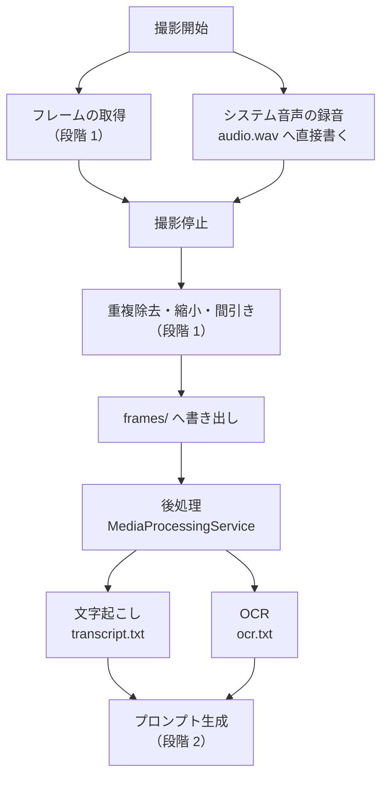

# 詳細設計書（段階 3：音声・OCR）

- 版：0.1
- 最終更新：2026-11-14
- 対応要件：F-11、F-12、F-13
- 前提：`docs/design/01-overview.md`、ADR-0005 / 0008 / 0016 / 0017 / 0018
- **この文書は設計の変更と同じ作業の中で更新する**

---

## 1. この段階の範囲

| ID | 要件 | 実現箇所 |
|---|---|---|
| F-11 | WASAPI ループバックで録音し、ローカルで文字起こし（日英・自動判定）。モデルのパスとサイズを設定可 | `LoopbackAudioRecorder` / `WhisperTranscriber` |
| F-12 | 残したフレームに OCR をかけ `ocr.txt` にまとめる（撮影時刻つき・重複除去） | `WindowsOcrEngine` / `OcrTextCollector` |
| F-13 | URL・投稿者名・キャプション・自由メモの入力欄 | **段階 2 で実装済み**（`PromptReviewViewModel`） |

---

## 2. 全体の流れ（段階 2 からの差分）



**音声だけが撮影と並行して動く。** 文字起こしと OCR は撮影が終わってから
（撮影中は CPU をキャプチャと符号化に使う。非機能要件「UI がもたつかない」）。

---

## 3. 音声の録音（F-11 / ADR-0016）

### 3.1 抽象（`NutLens.Core.Media`）

```csharp
/// 撮影と同時に動く録音。実装は WASAPI に触るので NutLens.Capture。
public interface IAudioRecorder : IAsyncDisposable
{
    /// 録音を始める。開始できなければ false（撮影は続ける）。
    bool TryStart(string destinationWavPath);

    /// 録音を止め、書けたバイト数を返す。始まっていなければ 0。
    Task<long> StopAsync();

    /// 開始に失敗した理由。利用者に出す。
    string? FailureReason { get; }
}
```

### 3.2 実装（`LoopbackAudioRecorder`）

```
WasapiRecorderBuilder().WithLoopbackCapture().Build()   （既定の再生デバイス）
   ↓ デバイス依存の形式（例：48 kHz / 2 ch / 32 bit float）
BufferedWaveProvider（ReadFully = false）
   ↓
MediaFoundationResampler
   ↓ 16 kHz / 1 ch / 16 bit PCM
WaveFileWriter → audio.wav
```

**録りながら落とす。** 撮影後にまとめて変換すると、一時データが 10 倍になる（ADR-0016 決定 1）。

#### `ReadFully = false` を外さないこと

`BufferedWaveProvider.ReadFully` の**既定は true**で、
たまった音が尽きても**無音を詰めて返す。**
そのため「取れるだけ取って書く」ループが永久に回り、
実際に **1.2 GB の WAV** が生成された（ADR-0016 実装で分かったこと 2）。

歯止めとして、書き出しが 128 MB を超えたら打ち切る（`LoopbackAudioRecorder.MaxBytes`）。
撮影時間の上限 3600 秒ぶんが約 115 MB なので、正常なら届かない。

**録音まわりを変えたら `--audio-idle` を走らせる**（§9.3）。
単体テストでは守れない（NAudio は `net10.0-windows` 側にあり、テストから参照できない）。

| 状況 | 挙動 |
|---|---|
| 再生デバイスが無い | `TryStart` が false。`FailureReason` に理由。撮影は続く |
| 途中でデバイスが変わった | 録音が止まる。そこまでの `audio.wav` を使う |
| `CaptureSettings.RecordAudio` が false | そもそも作らない |

---

## 4. 文字起こし（F-11 / ADR-0017）

### 4.1 抽象

```csharp
public sealed record TranscriptSegment(TimeSpan Start, TimeSpan End, string Text);

public sealed record TranscriptionResult(
    bool Succeeded,
    string? Language,              // 自動判定された言語
    IReadOnlyList<TranscriptSegment> Segments,
    string? SkipReason);           // 飛ばした理由（モデルが無い等）

public interface ITranscriber
{
    Task<TranscriptionResult> TranscribeAsync(
        string wavPath,
        IProgress<double>? progress,
        CancellationToken cancellationToken);
}
```

### 4.2 実装（`WhisperTranscriber`）

- `WhisperFactory.FromPath(モデルのパス)` → `CreateBuilder().WithLanguage("auto")`
- モデルが無ければ `Succeeded = false`、`SkipReason` に「モデルが見つかりません」
- **例外を外へ出さない。** 文字起こしの失敗で解析を止めない（概要設計 §10.1）

### 4.3 出力（`transcript.txt`）

```
# 文字起こし（言語: ja / モデル: ggml-base.bin）

[00:00.0 - 00:04.2] タクシーに乗ったら新幹線より速かった
[00:04.2 - 00:09.8] 20分で空港まで行けるかと尋ねたんですが
```

時刻を残すのは、フレームの経過秒と突き合わせられるようにするため。

---

## 5. OCR（F-12 / ADR-0018）

### 5.1 抽象

```csharp
public sealed record OcrLine(TimeSpan Elapsed, string Text);

public sealed record OcrResult(
    bool Succeeded,
    string? Language,
    int FramesWithText,
    int FrameCount,
    IReadOnlyList<OcrLine> Lines,
    string? SkipReason);

public interface IOcrEngine
{
    /// この環境で OCR が使えるか。使えないなら理由。
    bool IsAvailable(out string? reason);

    Task<OcrResult> RecognizeAsync(
        IReadOnlyList<(string Path, TimeSpan Elapsed)> frames,
        CancellationToken cancellationToken);
}
```

### 5.2 言語の選び方

```
OcrEngine.AvailableRecognizerLanguages から
1. ja があれば ja
2. 無ければ en
3. 無ければ最初の 1 つ
4. 1 つも無ければ使えない（理由を返す）
```

選んだ言語は `ocr.txt` の先頭に書く。
**日本語のテロップを英語の認識器で読むと意味のない文字列が並ぶ**ので、
何で読んだかが分からないと結果を判断できない。

### 5.3 分かち書きの解消と重複除去（`OcrTextCollector`。純ロジックなので Core）

**Windows の日本語 OCR は 1 文字ずつを「語」として返す。**
そのままだと「タ ク シ ー に 乗 っ た ら」という行になる。
これは認識器の都合であって、画面に出ていた文字列ではない。

```
出力に適用するもの（CollapseCjkSpacing）
  両隣が日本語の文字である空白を落とす  → 「タクシーに乗ったら」
  英数字の間の空白は残す                → 「TAXi 3」を「TAXi3」にしない
  全角の英数字（Ａ〜Ｚ・０〜９）も英数字として扱う

重複判定にだけ適用するもの（Normalize）
  1. 連続する空白を 1 つにまとめる
  2. Unicode 正規化 FormKC（全角と半角を揃える）
  3. 大文字小文字は揃えない（固有名詞の表記は手がかり）

同じ正規化結果が既にあれば捨てる。
残すのは最初に出たフレームの時刻だけ。
```

**全角半角の変換は出力に持ち込まない。** 画面に出ていた表記を変えない。

### 5.4 出力（`ocr.txt`）

```
# テロップ・字幕の OCR（言語: ja / フレーム 12 枚中 9 枚から検出）

[  0.0s] タクシーに乗ったら
[  0.0s] 新幹線より速かった
[  2.0s] 1台のタクシーを見つけました
```

---

## 6. 後処理の取り仕切り（`MediaProcessingService`。Core）

```csharp
public sealed record MediaProcessingResult(
    TranscriptionResult Transcription,
    OcrResult Ocr,
    IReadOnlyList<string> Warnings);   // 利用者に出す「できなかったこと」

public interface IMediaProcessingService
{
    Task<MediaProcessingResult> ProcessAsync(
        SessionLayout layout,
        IReadOnlyList<string> frameFiles,
        NutLensSettings settings,
        IProgress<MediaProcessingProgress>? progress,
        CancellationToken cancellationToken);
}
```

処理の順:

```
1. audio.wav があり、文字起こしが有効なら → ITranscriber → transcript.txt
2. frames/ があり、OCR が使えるなら       → IOcrEngine  → ocr.txt
3. できなかったことを Warnings に積む
```

**どちらが失敗しても、もう一方は続ける。** 両方失敗しても解析は続ける
（プロンプトには「ありません」と入る）。

書き出しは UTF-8（BOM つき）。利用者が開いて読むファイルなので
（段階 2 で `prompt.md` / `claude.log` を BOM つきにしたのと同じ理由）。

---

## 7. 設定の追加

```csharp
public sealed record CaptureSettings
{
    // …既存…
    public bool RecordAudio { get; init; } = true;        // ADR-0016 決定 5
}

public sealed record WhisperSettings
{
    public bool Enabled { get; init; } = true;
    public string? ModelPath { get; init; }               // null なら既定の場所
    // 既定: %LOCALAPPDATA%\NutLens\models\ggml-base.bin
}

public sealed record OcrSettings
{
    public bool Enabled { get; init; } = true;
    public string? PreferredLanguage { get; init; }       // null なら ja → en の順
}
```

`NutLensSettings` に `Whisper` と `Ocr` を足す。
**設定ファイルの版は上げない。** 項目が増えるだけで、既存の項目の意味は変わらない
（ADR-0015 決定 4 で版を上げたのは、`duplicateThreshold` の意味が変わったため）。

---

## 8. 画面

### 8.1 メインウィンドウ（追加）

| 要素 | 内容 |
|---|---|
| 音声を録る | チェックボックス（既定 オン） |
| 録音の注意 | 「システム全体の音を録ります。通知音や他のアプリの音も入ります。」（ADR-0016 決定 4） |
| 後処理の進捗 | 「文字起こし中…」「テロップを読んでいます…」 |
| できなかったことの表示 | 「文字起こしを飛ばしました（モデルが見つかりません）」など |

**警告色にしない。** 止める必要はないが、知らないと結果の理由が分からない種類のもの。

### 8.2 プロンプト確認画面（段階 2 から変化なし）

文字起こしと OCR の結果は `PromptInputs` 経由でプロンプトに入る（段階 2 で実装済み）。
利用者はプロンプトの本文として内容を確認・編集できる（F-22）。

---

## 9. テスト

| テストクラス | 確かめること |
|---|---|
| `OcrTextCollectorTests` | 同じ文字列が 1 回だけになる／全角と半角が揃う／大文字小文字は揃えない／最初に出た時刻が残る／空白だけの行は落ちる |
| `TranscriptFormatterTests` | 時刻の書式／言語とモデル名が先頭に入る／空のときの文言 |
| `OcrTextFormatterTests` | 検出枚数の表示／時刻の書式 |
| `MediaProcessingServiceTests` | 偽の `ITranscriber` / `IOcrEngine` で、片方が失敗しても片方は続く／両方失敗しても結果を返す／警告が積まれる／`audio.wav` が無ければ文字起こしを飛ばす |

**実物の音声と画像を使うテストは書かない**（CI で動かない、モデルが要る）。
実機確認は手で行い、結果をこの文書と ADR に残す。

現状：**172 件すべて成功。**

### 9.1 撮影を伴わない実機確認

`tools/NutLens.CaptureProbe` に 2 つの入口がある。**どちらも動画の再生を必要としない。**

```powershell
# この PC で何が使えるか（WGC・OCR の認識言語・Whisper のモデル・録音の開始可否）
dotnet run --project tools/NutLens.CaptureProbe -- --env

# 保存済みのフレームに OCR をかける
dotnet run --project tools/NutLens.CaptureProbe -- --ocr "<frames フォルダ>"
```

2026-11-14 の実測（この PC）:

```
Windows.Graphics.Capture : 使える
利用できる認識言語       : ja (日本語) のみ
Whisper のモデル         : ありません
WASAPI ループバック      : 開始できる
```

実物のフリップ動画 65 枚への OCR:

```
検出したフレーム: 65 / 65 枚
重複除去後の行  : 133 行
所要            : 4.7 秒（1 枚あたり 73 ms）

[   0.0s] タクシーに乗ったら
[   4.0s] 絶体絶命瞬間
[   6.0s] 1 台のタクシーを見つけました
[  10.1s] 20 分で空港まで
[  16.1s] メーター 4 倍の先払いを
```

**JPEG 品質 85 でも日本語の字幕はよく読める。**
一方、`©TAXi3 (2003)` のような英語のロゴは `@TAXロ ( 200a` などに崩れる
（この PC には `ja` しか入っていないため）。

### 9.2 文字起こしの確認（撮影なしでできた）

Windows の音声合成（SAPI）で WAV を作り、それを読ませる。

```powershell
dotnet run --project tools/NutLens.CaptureProbe -- --transcribe "test.wav"
```

| 入力 | 判定された言語 | 結果 | 所要 |
|---|---|---|---|
| 日本語 11.5 秒 | **ja** | 「タクシーに乗ったら新幹線より早かった。」ほか | 2.0 秒 |
| 英語 7.4 秒 | **en** | 誤りなし | 1.9 秒 |

**base モデルで音声の長さの約 1/6 の時間。** 60 秒の撮影なら 10 秒前後の見込み。
日本語は同音異義と語尾を誤る（「速かった」→「早かった」）が、
あらすじのキーワードは正しく出ている。

### 9.3 録音の確認（音を出さずにできる）

```powershell
dotnet run --project tools/NutLens.CaptureProbe -- 3 --audio-idle
```

音を再生せずに 3 秒ぶん録り、量と形式が妥当かを見る。
**ループバックは無音のバッファも届けるので、音が鳴っていなくても書き出しの経路を通る。**

```
書けた : 94 KB
目安   : 93 KB（3.0 秒ぶん）
判定   : 妥当（暴走していない）
形式   : 16000 Hz / 1 ch / 16 bit（3.0 秒）
```

**録音まわりを変えたら必ず走らせる。** 桁が違っていたら書き出しが暴走している。

### 9.4 まだ確認していないこと

| 項目 | 必要なもの |
|---|---|
| 録音に**実際に音が入るか** | `--audio-selftest <wav>`（**スピーカーから音が出る**ので実行は利用者） |
| BGM と重なったナレーションの精度 | 実物の動画での撮影 |
| 4 つの画面の見た目 | アプリの起動と操作 |

---

## 10. この段階でやらないこと

| 項目 | 段階 |
|---|---|
| Whisper モデルのダウンロード（進捗・中断・再開） | 5（D-04） |
| 設定画面でのモデルのサイズ選択 | 4 |
| Web Detection | 3' |
