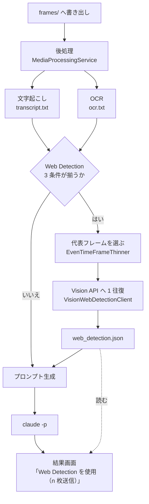

# 詳細設計書（段階 3'：Web Detection）

- 版：0.1
- 最終更新：2026-11-14
- 対応要件：F-14、5.6、D-07、D-08
- 前提：`docs/design/01-overview.md`、ADR-0002 / 0011 / 0019 / 0020 / 0021 / 0022
- **この文書は設計の変更と同じ作業の中で更新する**

---

## 1. この段階の範囲

| ID | 要件 | 実現箇所 |
|---|---|---|
| F-14 / 5.6 | フレーム全体を Google Cloud Vision の Web Detection にかけ、参考情報としてプロンプトへ入れる | `WebDetectionService` / `VisionWebDetectionClient` |
| 5.6 | 初期値オフ、同意ダイアログ、「高度な設定（上級者向け）」のラベル | `WebDetectionConsent` / メイン画面の折りたたみ |
| 5.6 | API キーを平文で保存しない・ログに出さない | `ISecretStore` / `CredentialManagerSecretStore` |
| 5.6 | `web_detection.json` を一時データとして置き、5.5 の規則で消す | `SessionLayout.WebDetectionFile`（段階 1 から存在） |

**この段階は「既定では 1 バイトも外へ出ない」ことが成立条件。**
利用者が同意ダイアログを通し、鍵を入れたときにだけ経路が開く。

---

## 2. 全体の流れ（段階 3 からの差分）



**`MediaProcessingService` の中に入れない。** あれは「文字起こしと OCR を行う役」で、
網の外へ出る処理を混ぜると、どのクラスが通信するのかが読めなくなる（ADR-0022 決定 2）。

---

## 3. 送信の可否（ADR-0021）

### 3.1 3 つの AND

```csharp
// NutLens.Core/WebDetection/WebDetectionGate.cs
public static bool CanSend(WebDetectionSettings settings, bool hasApiKey) =>
    settings.Enabled
    && settings.ConsentVersion == WebDetectionSettings.CurrentConsentVersion
    && hasApiKey;
```

| 条件 | 置き場 | 手で書けるか |
|---|---|---|
| `Enabled` | `settings.json` | 書ける |
| `ConsentVersion` | `settings.json` | 書けるが、**書いても通らない**（下記） |
| 鍵がある | Windows 資格情報マネージャー | **書けない** |

`ConsentVersion` を手で `1` にしても、**API キーは `settings.json` に存在しない**ので
3 つめが成立しない。鍵を入れるには同意ダイアログを通る必要がある。

**検査を足して弾くのではなく、手書きでは揃えられない条件を混ぜる。**

### 3.2 揃わなかったときの理由

送らない理由は画面に出し分ける。黙って何もしないと、
「有効にしたのに動かない」が原因不明になる。

| 揃っていないもの | 画面 |
|---|---|
| `Enabled` が false | 何も出さない（使わない設定なので正常） |
| `ConsentVersion` が古い | 「Web Detection の説明が更新されました。もう一度同意してください」 |
| 鍵が無い | 「Web Detection の API キーが設定されていません」 |

---

## 4. 鍵の預け先（ADR-0020）

### 4.1 抽象（`NutLens.Core.Security`）

```csharp
public interface ISecretStore
{
    /// <summary>無ければ null。例外にしない（「まだ入れていない」は正常な状態）。</summary>
    string? TryRead(string name);

    void Write(string name, string secret);

    /// <summary>無くても成功扱い。</summary>
    void Delete(string name);
}

public static class SecretNames
{
    public const string GoogleCloudVisionApiKey = "NutLens/GoogleCloudVision";
}
```

### 4.2 実装（`CredentialManagerSecretStore`。`NutLens.Capture`）

| 項目 | 値 |
|---|---|
| API | `CredWriteW` / `CredReadW` / `CredDeleteW` / `CredFree`（CsWin32 が生成） |
| `Type` | `CRED_TYPE_GENERIC` |
| `Persist` | `CRED_PERSIST_LOCAL_MACHINE` |
| `TargetName` | `NutLens/GoogleCloudVision` |
| `CredentialBlob` | UTF-16（`Encoding.Unicode`）のバイト列 |

#### `CredentialBlobSize` はバイト長

```csharp
byte[] blob = Encoding.Unicode.GetBytes(secret);
credential.CredentialBlobSize = (uint)blob.Length;   // 文字数ではない
```

**文字数を入れると鍵の末尾が切れた状態で保存され、
「認証エラー」としてしか表れる。** 保存は成功し、読み出しも成功し、
Google が拒否して初めて分かる。落ちる場所と原因が離れている。

### 4.3 鍵を外へ出さない 4 か所

| 出さない先 | どう守るか |
|---|---|
| `settings.json` | `WebDetectionSettings` に鍵のプロパティを**作らない** |
| `claude.log` | 鍵は `NutLens.Analysis` の HTTP 側にしか渡らない。claude の引数に現れない |
| `web_detection.json` | 書式を自前で決める（§6）。要求の中身を書かない |
| 例外・画面 | **HTTP の例外をそのまま上へ投げない。** §7 の短い文へ置き換える |

最後が落ちやすい。`HttpRequestException` の文面には要求 URI が入ることがあり、
**端点の URL には `?key=…` としてキーが入っている。**

---

## 5. 呼び方（ADR-0019）

### 5.1 抽象（`NutLens.Core.WebDetection`）

```csharp
public sealed record WebDetectionImage(string RelativePath, TimeSpan Elapsed, byte[] JpegBytes);

public enum WebDetectionStatus { Ok, Network, Auth, Quota, Invalid }

public sealed record WebEntity(string Description, double? Score);
public sealed record WebPageMatch(string Title, string Url);

public sealed record WebDetectionFrameResult(
    string File,
    double ElapsedSeconds,
    IReadOnlyList<string> BestGuessLabels,
    IReadOnlyList<WebEntity> WebEntities,
    IReadOnlyList<WebPageMatch> PagesWithMatchingImages);

public sealed record WebDetectionOutcome(
    WebDetectionStatus Status,
    int SentImageCount,
    IReadOnlyList<WebDetectionFrameResult> Frames,
    string? Message);

public interface IWebDetectionClient
{
    /// <summary><b>例外を投げない。</b>失敗は Status で返す。</summary>
    Task<WebDetectionOutcome> DetectAsync(
        IReadOnlyList<WebDetectionImage> images,
        string apiKey,
        TimeSpan timeout,
        CancellationToken cancellationToken);
}
```

`apiKey` を引数で受けるのは、**クライアントが鍵の出どころを知らないため**（ADR-0020 決定 3）。
資格情報マネージャーは Windows 専用で、`NutLens.Analysis` は `net10.0`。

### 5.2 実装（`VisionWebDetectionClient`。`NutLens.Analysis`）

```
POST https://vision.googleapis.com/v1/images:annotate?key=<APIキー>
```

```json
{
  "requests": [
    { "image": { "content": "<base64>" },
      "features": [ { "type": "WEB_DETECTION", "maxResults": 10 } ] }
  ]
}
```

- **`features` は `WEB_DETECTION` 1 つだけ。** `FACE_DETECTION` を入れない（要件が禁じている）
- 3 枚を `requests` 配列に並べて**1 往復**。1 枚ごとに送ると失敗の回数だけ課金される
- 要求も応答も型付き `record` ＋ `System.Text.Json` のソース生成（`VisionJsonContext`）
- 端点は定数。設定で変えられるようにしない（D-08）

### 5.3 拾うものと捨てるもの

| 応答 | 扱い |
|---|---|
| `bestGuessLabels[].label` | 使う |
| `webEntities[]`（`description` が空でないもの） | 使う |
| `pagesWithMatchingImages[]`（`url` と `pageTitle`） | 使う |
| `fullMatchingImages` / `partialMatchingImages` / `visuallySimilarImages` | **捨てる** |

捨てる側は画像ファイルの URL が並ぶだけで作品名に繋がらない。
載せると**Claude の利用枠を参考情報の残骸で消費する**。

---

## 6. `web_detection.json`（ADR-0022 決定 3・4）

### 6.1 書式（こちらで決める。Google の応答そのままではない）

```json
{
  "status": "ok",
  "sentImageCount": 3,
  "message": null,
  "frames": [
    {
      "file": "frames/frame_001_t0000.0s.jpg",
      "elapsedSeconds": 0.0,
      "bestGuessLabels": ["movie scene"],
      "webEntities": [ { "description": "…", "score": 0.72 } ],
      "pagesWithMatchingImages": [ { "title": "…", "url": "https://…" } ]
    }
  ]
}
```

失敗のときは `frames` が空、`status` が `ok` 以外、`message` に短い説明。

### 6.2 読む役（`WebDetectionDocument`。Core）

```csharp
public static WebDetectionOutcome? TryRead(string path);

/// <summary>status が ok のときだけ本文を返す。それ以外は null。</summary>
public static string? TryReadReference(string path);
```

`AnalysisService.PreparePrompt` は `TryReadReference` を使う。
**`PromptComposer` は置換だけの役のまま変えない**（ADR-0022 決定 6）。
あれに JSON の解釈を足すと、テンプレートの不具合と応答の不具合が同じ場所で起きる。

### 6.3 1 ファイルで足りる理由

結果画面まで状態を運ぶのに、画面の引数を増やさない。

| `status` | 結果画面 |
|---|---|
| ファイルが無い | 何も出さない |
| `ok` | 「Web Detection を使用（n 枚送信）」 |
| それ以外 | 「Web Detection は使えませんでした（理由）。解析は続けました」 |

`web_detection.json` は一時データなので、ほかと一緒に消える（5.5）。
**「n 枚送った」という事実が残り続けないことは、5.5 の趣旨に合う。**

---

## 7. 失敗の分け方（ADR-0022 決定 5）

| 起きたこと | `Status` | 画面に出す文 |
|---|---|---|
| 名前解決・接続不可・タイムアウト | `Network` | ネットワークに繋がりませんでした |
| HTTP 401 / 403 | `Auth` | API キーが拒否されました。キーと Vision API の有効化をご確認ください |
| HTTP 429 または `RESOURCE_EXHAUSTED` | `Quota` | 利用上限に達しました |
| HTTP 400・応答が読めない | `Invalid` | 応答を読み取れませんでした |

**いずれも例外を外に投げない。** 補助情報が取れなかっただけで解析を止めない
（概要設計 §10.1。文字起こし・OCR と同じ扱い）。

タイムアウトは既定 30 秒。**撮影が終わったのに画面が進まない状態を作らない。**

---

## 8. 取り仕切り（`WebDetectionService`。Core）

```csharp
public interface IWebDetectionService
{
    /// <summary>
    /// 条件が揃っていなければ null を返して何もしない（送らない）。
    /// 送った場合は web_detection.json を書いて結果を返す。
    /// </summary>
    Task<WebDetectionOutcome?> RunAsync(
        SessionLayout layout,
        NutLensSettings settings,
        IList<string> warnings,
        CancellationToken cancellationToken);
}
```

手順:

1. `WebDetectionGate.CanSend` を見る。揃っていなければ §3.2 の理由を `warnings` に足して null
2. `IFrameFileLister` で `frames/` を並べる
3. `IFrameThinner.Thin(frames, MaxImages)` で代表を選ぶ（**新しい選び方を作らない**）
4. 選んだ JPEG を読む
5. `IWebDetectionClient.DetectAsync`
6. 結果を `web_detection.json` へ書く（成功・失敗とも）
7. 失敗なら `warnings` に §7 の文を足す

### 8.1 呼ばれる場所

`CaptureViewModel.ProcessMediaAsync` の後段（撮影の直後）。

**プロンプト確認画面からは呼ばない。** あの画面はメモを打つたびに
`Rebuild()` でプロンプトを作り直すので、**打鍵のたびに課金される。**

---

## 9. 設定の追加

```jsonc
{
  "webDetection": {
    "enabled": false,        // 既定オフ（5.6）
    "consentVersion": 0,     // 同意ダイアログだけが書く（ADR-0021）
    "maxImages": 3,          // 5.6 の初期値
    "timeoutSeconds": 30
  }
}
```

| 項目 | 既定 | 範囲 |
|---|---|---|
| `Enabled` | **false** | — |
| `ConsentVersion` | 0 | — |
| `MaxImages` | 3 | 1〜10 |
| `TimeoutSeconds` | 30 | 5〜120 |

- **API キーはここに入らない**（ADR-0020）
- `NutLensSettings.CurrentVersion` は**上げない**。既存の項目の意味は変わらないため（ADR-0021 決定 6）
- `Normalize()` に `this.WebDetection ?? new WebDetectionSettings()` を足す。
  ソース生成の逆直列化はプロパティ初期化子を走らせないため（段階 1 で同じ事故を起こしている）

---

## 10. 画面

### 10.1 メインウィンドウ（追加）

**「高度な設定（上級者向け）」という見出しの折りたたみ。** 既定は閉じている。
この文字列を画面に出すこと自体が 5.6 の要求。

```
▸ 高度な設定（上級者向け）
    ☐ Web Detection を使う（フレームが Google に送られます）
    [ API キーを設定する… ]  [ API キーを削除する ]
    送る枚数: [3]
```

- チェックを入れようとすると**同意ダイアログが出る**。同意しなければチェックは元に戻る
- 段階 4 で設定画面へ移す

### 10.2 同意ダイアログ（`IUserInteraction` 経由）

```
Web Detection を有効にします。

・選んだフレーム（最大 3 枚）が Google に送られます。
・利用者ご自身の Google Cloud の API キーと課金設定が必要です。
  利用料がかかる場合があります。
・Google Cloud の規約に従ってご利用ください。

送るのはフレーム全体です。顔の検出や人物の特定には使いません。
```

「同意する」で `Enabled = true` と `ConsentVersion = CurrentConsentVersion` を**同時に**書く。
片方だけ書く経路をコードに作らない。

文字列は `Strings.resx`（D-09。XAML に日本語を直接書かない）。

### 10.3 結果画面（追加）

§6.3 の 1 行を候補一覧の下に出す。URL はクリックで開ける（F-26 の既存の仕組み）。

---

## 11. analyzer 側（`analyzer/CLAUDE.md`）

既に書いてある:

> `web_detection.json` … 外部の画像検索の参考情報（**利用者が明示的に有効にしたときだけ**存在する）
> この参考情報は手がかりの一つにすぎず、ほかの手がかりとの照合なしに結論にしない

足すこと:

> `status` が `ok` 以外のときは、参考情報は**無いものとして**扱う。

---

## 12. テスト

| 対象 | 確かめること |
|---|---|
| `WebDetectionGate` | 3 条件の AND。**`Enabled` だけ true では送らない**／`ConsentVersion` が古いと送らない／鍵が無いと送らない |
| `WebDetectionDocument` | 書いて読んで同じ／`status` が `ok` 以外なら `TryReadReference` が null／壊れた JSON で例外にならない |
| `WebDetectionService` | 偽の `IWebDetectionClient` を差し込み、送った枚数が `MaxImages` 以下／選ばれるのが最初と最後を含む均等な並び／失敗時も `web_detection.json` が書かれる／`warnings` に理由が入る |
| `VisionRequestBuilder` | `features` が `WEB_DETECTION` 1 つだけ（**`FACE_DETECTION` が入らない**）／3 枚が 1 リクエストに並ぶ |
| `VisionResponseReader` | `bestGuessLabels` / `webEntities` / `pagesWithMatchingImages` だけを拾う／`visuallySimilarImages` を捨てる／`error` が入った応答を `Auth` / `Quota` に振り分ける |
| `NutLensSettings` | `"webDetection": null` で落ちない／`maxImages` が範囲外でも丸まる |
| `AnalysisService` | `status` が `ok` のときだけプロンプトに差し込まれる |

### 12.1 単体テストで守れないこと

| 項目 | なぜ守れないか | 確かめ方 | 結果 |
|---|---|---|---|
| `CredWrite` / `CredRead` の往復 | Windows 専用 API。テストは `net10.0` で `NutLens.Capture` を参照できない | `--secret-selftest` | **確認済み**（§12.2） |
| 3 条件の揃い具合（実環境） | 設定ファイルと資格情報マネージャーの実物を見る | `--env` | **確認済み** |
| Vision API が実際に応答するか | **利用者の API キーと課金設定が要る** | `--web-detect` | **未検証** |
| 資格情報マネージャーの一覧の見え方 | 目視 | コントロール パネル | **未目視** |
| 同意ダイアログ・折りたたみの見え方 | 目視 | アプリを起動 | **未目視** |

**下 3 つは段階 3' の完了時点で未検証のまま残る。**
ADR の状態を「実測・実機で確認」に上げない。

### 12.2 鍵まわりを触ったら必ず走らせる

```powershell
dotnet run --project tools/NutLens.CaptureProbe -- --secret-selftest
```

本物の鍵には触らず、`NutLens/SelfTest` という別の名前で書いて読んで消す。
一番確かめたいのは `CredentialBlobSize` がバイト長であること（§4.2）。

実測（2026-11-14）:

```
書く値   : 26 文字          ← 日本語を混ぜてある
読めた値 : 26 文字
往復     : 一致（末尾が切れていない）
削除     : 消えた
```

### 12.3 送信を伴う確認（課金される）

```powershell
# 3 条件の揃い具合だけ見る（通信しない）
dotnet run --project tools/NutLens.CaptureProbe -- --env

# 保存済みのフレームで実際に送る（既定 3 枚＝3 ユニット）
dotnet run --project tools/NutLens.CaptureProbe -- --web-detect "<frames>"
```

`--web-detect` は**アプリと同じ選び方**（§3 の 3 条件は通さないが、代表フレームの選び方は同じ）を使う。
鍵は資格情報マネージャーから読む。**引数で鍵を受け取らない**（コマンド履歴に平文で残るため）。

---

## 13. この段階でやらないこと

| やらないこと | いつ |
|---|---|
| 設定画面（折りたたみを移す先） | 段階 4 |
| 送信前にプロンプト確認画面で「送る／送らない」を選ばせる | 段階 4（ADR-0022 宿題） |
| 課金額の表示・見積もり | 段階 4 以降（単価を確かめてから） |
| 顔に関する一切の機能 | **実装しない**（要件が禁じている） |
