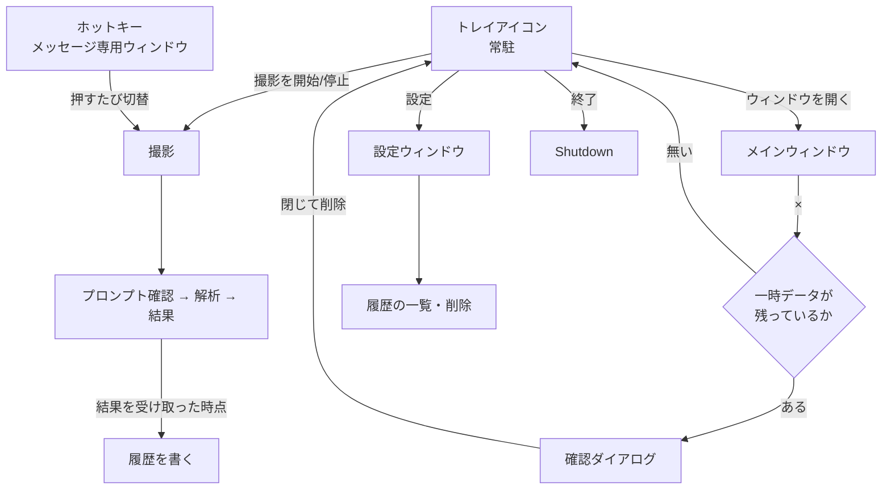
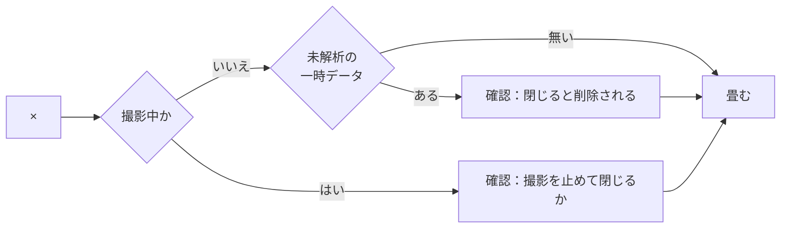

# 詳細設計書（段階 4：使い勝手）

- 版：0.1
- 最終更新：2026-11-14
- 対応要件：F-04、F-28、5.5、6 章（トレイ常駐・エラーメッセージ）
- 前提：`docs/design/01-overview.md`、ADR-0009 / 0023 / 0024 / 0025 / 0026
- **この文書は設計の変更と同じ作業の中で更新する**

---

## 1. この段階の範囲

| ID | 要件 | 実現箇所 |
|---|---|---|
| F-04 | グローバルホットキーで撮影の開始・停止（キーは設定で変えられる） | `HotkeyGesture` / `HotkeyService` |
| F-28 | 履歴の一覧（第一候補・他の候補・日時・メモ）。**サムネイルを持たない** | `HistoryEntry` / `JsonHistoryStore` |
| 6 章 | タスクトレイに常駐し、すぐ撮影を始められる | `TrayIconService` |
| 5.5 | 履歴を設定画面から個別・一括で消せる | `SettingsWindow` の履歴タブ |
| 5.5 | 一時データの自動削除 | **①②③は実装済み。**④（畳んだとき）を足す |
| 6 章 | 原因が分かるエラーメッセージ | `ExceptionMessageMapper` |
| 5.6 | 「高度な設定（上級者向け）」を設定画面へ移す | `SettingsWindow` |

---

## 2. 常駐と画面の関係



**ホットキーとトレイは、メインウィンドウの寿命に依存しない。**
どちらもアプリの起動から終了まで生き続ける。

---

## 3. ホットキー（F-04 / ADR-0023）

### 3.1 抽象（`NutLens.Core.Input`）

```csharp
public interface IHotkeyService : IDisposable
{
    /// <summary>登録できたら true。できなくても例外にしない（ADR-0023 決定 4）。</summary>
    bool TryRegister(HotkeyGesture gesture);

    void Unregister();

    /// <summary>押された。開始と停止の切り替えは購読側が決める（決定 5）。</summary>
    event EventHandler? Pressed;
}
```

### 3.2 `HotkeyGesture`（Core の純ロジック）

```csharp
public readonly record struct HotkeyGesture(HotkeyModifiers Modifiers, uint VirtualKey)
{
    public static bool TryParse(string? text, out HotkeyGesture gesture);
    public override string ToString();   // "Ctrl+Shift+F9"
}

[Flags]
public enum HotkeyModifiers { None = 0, Alt = 1, Control = 2, Shift = 4, Windows = 8 }
```

値は Win32 の `MOD_ALT` / `MOD_CONTROL` / `MOD_SHIFT` / `MOD_WIN` と同じにする。
**Core は Windows の API を参照できない**（`net10.0`。ADR-0002）ので、
数値だけを合わせて `uint` で渡す。

受け付ける書式:

| 書き方 | 解釈 |
|---|---|
| `Ctrl+Shift+F9` | 既定 |
| `Control+Shift+F9` | 同じ |
| `ctrl + shift + f9` | 同じ（大小と空白を無視する） |
| `Win+Alt+S` | `MOD_WIN` ＋ `MOD_ALT` ＋ `S` |
| `F9` | 修飾なし。**受け付けるが、他のアプリに取られやすい** |

対応するキー：`A`〜`Z`、`0`〜`9`、`F1`〜`F24`。
**それ以外は受け付けない。** 記号キーは配列によって仮想キーコードが変わり、
「設定した通りに効かない」という形で表れる。

### 3.3 実装（`HotkeyService`。`NutLens.Capture`）

ADR-0023 の影響の欄には「実装は `NutLens.App`」と書いたが、
**CsWin32 が生成する `PInvoke` は `NutLens.Capture` の内部にしか見えない。**
`NutLens.Capture` は「撮影の層」ではなく**「Windows 専用の実装を置く層」**であり
（ADR-0002 / ADR-0020 決定 3 と同じ整理）、`UseWPF` も既に有効なので `HwndSource` が使える。

`HwndSource` を `HWND_MESSAGE`（`-3`）の子として作る。

```csharp
HwndSourceParameters parameters = new("NutLensHotkey")
{
    ParentWindow = new IntPtr(HwndMessage),   // -3
};
```

**メインウィンドウのハンドルに登録しない**（ADR-0023 決定 2）。
畳んだ後にハンドルが無効になると、ホットキーが黙って効かなくなる。

`WM_HOTKEY`（`0x0312`）をフックで受け、`Pressed` を上げる。

### 3.4 設定を変えるときの順序

**先に登録、成功してから保存**（ADR-0023 決定 6）。

```
1. 新しいキーで RegisterHotKey を試す
2. 成功 → 古い登録を外し、設定を保存する
3. 失敗 → 古い登録のまま。理由を出し、保存しない
```

**逆にすると、効かないキーが設定ファイルに残り、次の起動から黙って効かなくなる。**

---

## 4. トレイ常駐と終了（6 章 / ADR-0025）

### 4.1 抽象（`NutLens.Core.Ui`）

```csharp
public interface ITrayIconService : IDisposable
{
    void Show();

    /// <summary>撮影中かどうかでアイコンを変える（ADR-0025 決定 6）。</summary>
    void SetCapturing(bool capturing);

    event EventHandler? ToggleCaptureRequested;
    event EventHandler? OpenWindowRequested;
    event EventHandler? OpenSettingsRequested;
    event EventHandler? ExitRequested;
}
```

### 4.2 `ShutdownMode`

```csharp
this.ShutdownMode = ShutdownMode.OnExplicitShutdown;
```

**これを変えないと、最後のウィンドウを閉じた瞬間にプロセスが終わり、常駐できない。**
代わりに、**どこかで `Shutdown()` を呼び忘れるとプロセスが残り続ける**
（タスクマネージャにしか現れない）。終了の経路は「トレイの終了」1 つに絞る。

### 4.3 ×を押したとき（5.5 の 4 つめの契機）



| 状態 | 確認 |
|---|---|
| 一時データが無い（ほとんどの回） | **出さない。** 黙って畳む |
| 撮影したが解析していない | 出す。既定は「キャンセル」 |
| 撮影中 | 出す。「はい」で撮影を止めてから畳む |

**消すものが無いときに確認を出さない**のが要。
毎回出る確認は読まれなくなり、本当に消える回にも「はい」を押す動作だけが残る。

②「次の撮影を始めたとき」で確認を出さないのとは扱いが違う。
あちらは**意図がはっきり「次を撮る」**で、×は「捨てる」という意思表示ではない。

### 4.4 アイコン

`Resources/tray-idle.ico` と `Resources/tray-capturing.ico`。
畳んだ状態でホットキーから撮影が始まると、**画面を見ずに撮影が始まる**ので、
動いていることがアイコンで分かる必要がある。

---

## 5. 履歴（F-28 / ADR-0024）

### 5.1 抽象（`NutLens.Core.History`）

```csharp
public sealed record HistoryCandidate(
    string? TitleJa, string? TitleOriginal, int? Year, string Type,
    double Confidence, IReadOnlyList<string> Evidence,
    IReadOnlyList<string> Mismatches, IReadOnlyList<string> Sources);

public sealed record HistoryEntry(
    int Version, string Id, DateTimeOffset SavedAt,
    IReadOnlyList<HistoryCandidate> Candidates,
    IReadOnlyList<string> UnverifiedPoints,
    string? SourceUrl, string? AuthorName, string? Caption, string? FreeText,
    int Turns, double DurationSeconds, decimal? CostUsd);

public interface IHistoryStore
{
    IReadOnlyList<HistoryEntry> List();   // 新しい順
    void Save(HistoryEntry entry);
    void Delete(string id);
    void DeleteAll();
}
```

### 5.2 置き場と名前

```
%LOCALAPPDATA%\NutLens\history\
  20261114T093012_<セッションID>.json
```

1 解析 1 ファイル。**索引を持たない**（ADR-0024 決定 1）。
一覧はディレクトリを列挙して作る。

名前の先頭に日時（`yyyyMMddTHHmmss`）を置くのは、名前の順＝時間の順にするため。
コロンはファイル名に使えないので入れない。

### 5.3 **書かないもの**

| 書く | 書かない |
|---|---|
| 日時・候補・確信度・根拠・確認できなかった点・参考 URL | **サムネイル**（F-28 が禁止） |
| 利用者のメモ（URL・投稿者・キャプション・自由記述） | フレームのパス |
| ターン数・所要時間・費用 | **文字起こし**・**OCR の結果** |
| | プロンプト・`claude.log`・`web_detection.json` |

**文字起こしと OCR がここで一番間違えやすい。**
どちらもテキストだが、**撮影した音声・画像から作ったデータ**であり、
5.5 の表では一時データの側にある。残すと「解析が終わったら消す」が嘘になる。

### 5.4 いつ書くか

`AnalysisWorkflow` が `claude` の結果を受け取った**直後**、結果画面を開く前。

**閉じるときに書かない。** 落ちたとき・強制終了されたときに、
利用枠を使って得た結果だけが消える。

再調査（F-27）で結果が変わったら、**同じ `Id`（＝セッション ID）で上書きする。**
ファイル名の日時は最初の保存のものを使い回す（名前が変わると 2 つ残る）。

### 5.5 壊れたファイル

読めなかったファイルは**消さず、一覧から外す**。
壊れた設定ファイルを退避するのと同じ扱い（利用者が中身を確かめられる）。

---

## 6. 設定画面

### 6.1 構成（1 ウィンドウ・4 つの区画）

| 区画 | 中身 |
|---|---|
| 撮影 | 間隔・時間・重複しきい値・最大枚数・長辺 px・JPEG 品質・カーソル |
| 解析 | `claude` のパス・`--max-turns`・Whisper のモデル・OCR の言語・録音 |
| 履歴 | 一覧（日時・第一候補・メモ）・個別削除・**すべて削除** |
| 高度な設定（上級者向け） | ホットキー・Web Detection・一時データを残す |

**「高度な設定（上級者向け）」という見出しは 5.6 の要求そのもの。**
段階 3' でメイン画面に置いた折りたたみを、ここへ移す。

### 6.2 保存の仕方

**「保存」で明示的に保存する。** 閉じるボタンでは保存しない。

例外が 2 つある。どちらも「値の編集」ではなく「操作」だから。

| 操作 | いつ効くか |
|---|---|
| API キーの設定・削除（ADR-0020） | その場で資格情報マネージャーに書く／消す |
| Web Detection を有効にする（ADR-0021） | 同意ダイアログを通った時点で保存する |
| 履歴の削除 | その場で消す |

ホットキーは §3.4 の順序（登録 → 保存）を通るので、「保存」で確定する。

---

## 7. エラー処理（6 章 / ADR-0026）

### 7.1 窓口

```csharp
public interface IExceptionDescriber
{
    string Describe(Exception exception);
}
```

ViewModel は `switch` を持たない。`Describe` を呼ぶだけ。

### 7.2 対応表

**例外を足したら、この表に 1 行足すまでが 1 つの作業**（ADR-0026 決定 5）。

| 例外 | 文言（`Strings.resx` のキー） | 出すときに添えるもの |
|---|---|---|
| `CaptureUnavailableException` | `ErrorCaptureUnavailable` | — |
| `CaptureTargetLostException` | `ErrorTargetLost` | — |
| `CaptureDeviceException` | `ErrorCaptureDevice` | — |
| `ClaudeNotFoundException` | `ErrorClaudeNotFoundFormat` | **探した場所を全部** |
| `ClaudeExecutionException` | `ErrorClaudeExecution` | — |
| `AnalyzerTemplateException` | `ErrorAnalyzerTemplate` | — |
| `SettingsCorruptedException` | `ErrorSettingsCorruptedFormat` | **退避先のパス** |
| `OperationCanceledException` | `AnalysisCancelled` | — |
| 上記以外 | `ErrorUnexpectedFormat` | **例外の型名＋メッセージ** |

最後の行が要。「エラーが発生しました」だけにすると、
**不具合報告から原因を追えない。** 型名は利用者に理解させるためではなく、
**報告に貼れるようにする**ために出す。

### 7.3 例外にしないもの

| 状況 | 扱い |
|---|---|
| 音声デバイスが無い・録音に失敗 | **警告。撮影は続く**（ADR-0016 決定 3） |
| 文字起こし・OCR が飛んだ | 警告。解析は続く |
| Web Detection が失敗 | 警告。解析は続く（ADR-0022 決定 5） |

**取れなかっただけで止めるものと、止めないものを混ぜない**（概要設計 §10.1）。

---

## 8. 設定の追加

```jsonc
{
  "hotkey": {
    "enabled": true,
    "gesture": "Ctrl+Shift+F9"
  }
}
```

| 項目 | 既定 |
|---|---|
| `Hotkey.Enabled` | true |
| `Hotkey.Gesture` | `Ctrl+Shift+F9` |

`NutLensSettings.CurrentVersion` は上げない（既存の項目の意味が変わらない）。
`Normalize()` に `this.Hotkey ?? new HotkeySettings()` を足す
（ソース生成の逆直列化はプロパティ初期化子を走らせない）。

---

## 9. テスト

| 対象 | 確かめること |
|---|---|
| `HotkeyGesture` | `Ctrl+Shift+F9` の往復／大小・空白を無視／`F1`〜`F24`・`A`〜`Z`・`0`〜`9`／**記号キーを受け付けない**／壊れた文字列で例外にしない |
| `JsonHistoryStore` | 書いて読める／新しい順に並ぶ／個別削除／一括削除でフォルダは残る／**同じ ID の保存で増えない**（上書き）／壊れたファイルを消さずに飛ばす |
| `HistoryEntry` の作り方 | **文字起こし・OCR・フレームのパスが入らない**（5.5 の境目） |
| ~~`ExceptionMessageMapper`~~ | **テストできない。** App は `net10.0-windows`、テストは `net10.0`（§9.1） |
| `NutLensSettings` | `"hotkey": null` で落ちない／既定が `Ctrl+Shift+F9` |

### 9.1 単体テストで守れないこと

| 項目 | 確かめ方 | 結果 |
|---|---|---|
| ホットキーを**登録できる**か | `--hotkey-selftest`（ウィンドウを出さない） | **できた**（§9.2） |
| H.NotifyIcon.Wpf が .NET 10 で動くか | アプリを起動して可視ウィンドウを数える | **起動は通った** |
| `WM_HOTKEY` が**押したときに**届くか | アプリを起動して押す | **未検証** |
| ×でトレイへ畳まれること・確認が出ること | 目視 | **未目視** |
| トレイのアイコンとメニューの見え方 | 目視 | **未目視** |
| 例外から文言への変換（`ExceptionMessageMapper`） | **目視しかない**（App は `net10.0-windows`、テストは `net10.0`） | **未目視** |

**下 4 つは段階 4 の完了時点で未検証のまま残る。**
ADR の状態を実際より強く書かない。

### 9.2 ホットキーまわりを触ったら必ず走らせる

```powershell
dotnet run --project tools/NutLens.CaptureProbe -- --hotkey-selftest
dotnet run --project tools/NutLens.CaptureProbe -- --hotkey-selftest "Ctrl+Alt+S"
```

ウィンドウは出ない。メッセージ専用ウィンドウを作って登録し、すぐ外す。
**この組み合わせがこの PC で空いているか**も分かる。

実測（2026-11-14）:

```
入力     : Ctrl+Shift+F9
正規化後 : Ctrl+Shift+F9
修飾     : Control, Shift（Win32 と同じ値: 6）
仮想キー : 0x78
登録     : できた（この組み合わせは空いている）
```

録音（04 §9.3）・資格情報（05 §12.2）と同じく、**単体テストでは守れない。**
`RegisterHotKey` は Windows 専用 API で、テストは `net10.0`。

---

## 10. この段階でやらないこと

| やらないこと | いつ／理由 |
|---|---|
| 履歴の検索・絞り込み | 要件に無い。使ってから決める |
| 履歴の自動削除（古いものを消す） | **作らない。** 利用者の記録を勝手に消すことになる |
| 初回セットアップ画面（D-03） | 段階 5 |
| 自動更新（D-02） | 段階 5 |
| 「このアプリについて」（D-06） | 段階 5（`THIRD_PARTY_NOTICES.md` と一緒） |
| Core に残る日本語の警告文の移動 | 段階 5（英語化とまとめて。ADR-0026 宿題） |
