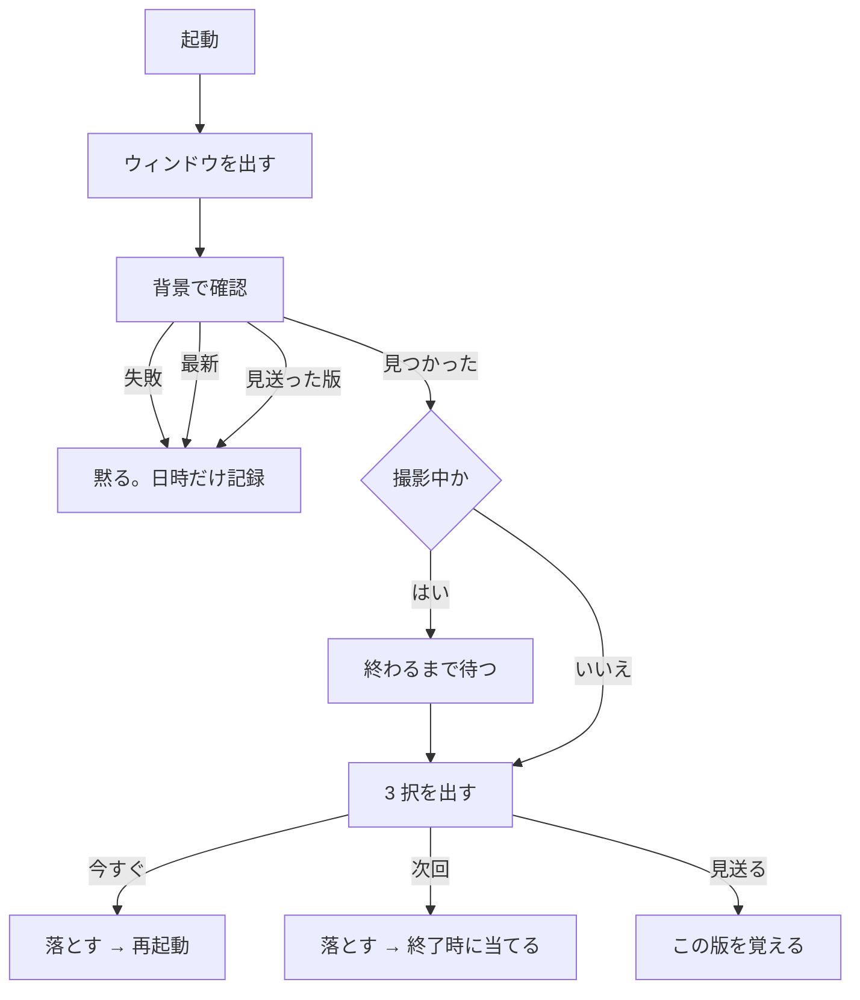

# 詳細設計書（段階 5：配布）

- 版：0.1
- 最終更新：2026-11-14
- 対応要件：D-01〜D-15（10 章）
- 前提：`docs/design/01-overview.md`、ADR-0027 / 0028 / 0029 / 0030 / 0031 / 0032 / 0033 / 0034 / 0035
- **この文書は設計の変更と同じ作業の中で更新する**

---

## 1. この段階の範囲

| ID | 要件 | 実現箇所 |
|---|---|---|
| D-01 | インストーラー（Velopack）／アンインストールの挙動 | `Program.Main` / `build/Distribution.props` / `release.yml` |
| D-02 | GitHub Releases からの自動更新（同意を得てから） | `IUpdateService` / `VelopackUpdateService` / `UpdatePrompt` |
| D-03 | 初回セットアップ（確認と案内。導入は自動化しない） | `ISetupChecker` / `SetupChecker` / `SetupWindow` |
| D-04 | Whisper モデルを同梱せず、選んで落とす（進捗・中断・再開） | `IModelDownloader` / `WhisperModelDownloader` |
| D-06 | ライセンスを `THIRD_PARTY_NOTICES.md` に／画面から見られる | `THIRD_PARTY_NOTICES.md` / `AboutWindow`（段階 4 の後に実装済み） |
| D-07 | 利用枠と送信内容を初回セットアップと README に明記 | `SetupWindow` / `README.md` |
| D-10 | 署名の方針を `CODE_SIGNING_POLICY.md` に | `CODE_SIGNING_POLICY.md`（**ADR-0032 で読み替えた**。§7） |
| D-13 | タグを打つと GitHub Actions でビルド〜公開 | `.github/workflows/release.yml` |
| D-05 | **保存先**を固定で書かない／設定で変えられる | `DataRoot` / 設定画面の「高度な設定」（§11） |
| D-14 | 秘密情報をリポジトリに置かない | `.gitignore` / ワークフローは `secrets` 参照のみ |
| D-15 | README・SECURITY・CONTRIBUTING・Issue テンプレート | 各ファイル（**README は日英併記の 1 本**。§8） |

---

## 2. 配布に関わる値は 1 箇所に集める（ADR-0031 決定 7）

```
build/Distribution.props
  DistributionOwner       MixedNutsJP
  DistributionRepository  NutLens
  RepositoryUrl           https://github.com/<owner>/<repo>
  VelopackPackageId       NutLensApp     ← インストール先のフォルダ名になる
  VelopackPackageTitle    NutLens        ← 画面に出る名前
```

`Directory.Build.props` が読み込み、`AssemblyMetadata` として実行時にも届ける。
`release.yml` も同じファイルから `grep` で読む。

**コードにも複数の yml にも散らさない。** リポジトリを移したときに直す場所を 1 つにする。

---

## 3. インストール先（ADR-0027 決定 2）

**ここが段階 5 でいちばん壊しやすい。**

```
%LOCALAPPDATA%\NutLensApp\       ← アプリ本体。Velopack が作り、消す
%LOCALAPPDATA%\NutLens\          ← 利用者のデータ。**Velopack は触らない**
    settings.json
    history\
    work\
    models\
```

パッケージ ID を `NutLens` にすると、インストール先が `%LOCALAPPDATA%\NutLens` になり、
**アンインストールが履歴ごと消す**（D-01 違反）。
データの置き場は 6 章と 5.5 が名指ししていて動かせないので、**インストール先を逃がす。**

**気づけるのはアンインストールしたときだけ**で、そのときには戻せない。

### 3.0 インストール先は画面で選べる（ADR-0035）

```
NutLens-Setup.exe（Inno 製・配るのはこれ 1 つ）
  ├ ディレクトリ選択ページ
  ├ 中に Velopack の Setup.exe を抱えている
  └ Setup.exe --installto <選ばれたフォルダ>
       └ 以降のインストール・更新・アンインストールは Velopack
```

Velopack の `Setup.exe` にはフォルダ選択の画面が無く、`--installto` は
コマンドラインだけ。**Inno は入口の画面だけを足す。**

| 設定 | 値 | 理由 |
|---|---|---|
| `Uninstallable` | **`no`** | アンインストールの口を 2 つ作らない |
| `CreateAppDir` | `yes` | ディレクトリ選択ページを出すために要る |
| `PrivilegesRequired` | `lowest` | UAC を出さない。更新も昇格なし |
| `DefaultDirName` | `{localappdata}\NutLensApp` | Velopack の既定と揃える |

**空でないフォルダを選ばれたら警告する。**
Velopack のアンインストールはルートの中身を選別せずに全部消すので、
共用フォルダを選ばれると他人のファイルごと消える。止めはしないが、黙って通さない。

**`--silent` では呼ばない。** .NET ランタイムの導入まで黙って進み、
失敗したときに何も見えなくなる。終了コードを見て失敗を報せる。

**本体をどこに入れても、データの置き場は変わらない。**
インストール先には、こちらから何も書かない
（`AppContext.BaseDirectory` と `RootAppDir` は読むためだけに使う）。
例外は保存先を変更したときの `data-dir.txt` 1 つだけ。

### 3.1 アンインストールで消すもの

`Program.OnBeforeUninstall` が消すのは 2 つだけ。

| 対象 | 扱い |
|---|---|
| `work\` | **消す**（D-01） |
| `settings.json` | 消す |
| `history\` | **残す**（D-01：利用者が選べる） |
| `models\` | **残す**（落とし直しに時間がかかる） |
| 資格情報マネージャーの API キー | **残す**（利用者が自分で消せる場所にある） |

**Velopack はルートの中身を選別せずに全部消す**（`remove_dir_contents(&root_path)`）。
上の表が成り立つのは、**データがインストール先の外にあるから**である。
インストール先にデータを置くと、アンインストールで履歴ごと消える。

**ここで UI を出さない。** アンインストール中に動く UI は最も壊れやすい。
**例外も投げない。** 投げるとアンインストールが途中で止まる。

残したものの消し方は README に書いてある。

---

## 4. 入口（ADR-0027 決定 4）

```csharp
[STAThread]
public static void Main(string[] args)
{
    VelopackApp.Build()
        .OnBeforeUninstallFastCallback(OnBeforeUninstall)
        .Run();                       // ← ここより前に何も書かない

    App app = new();
    app.InitializeComponent();
    app.Run();
}
```

`NutLens.App.csproj` に `<StartupObject>NutLens.App.Program</StartupObject>` が要る。

**これが無いと、WPF が生成した `Main` が使われ、フックが動かない。**
しかも**アプリは普通に起動する**ので気づけない。
気づくのは「更新したのに新しくならない」「アンインストールしても残る」という形。

---

## 5. 更新（D-02 / ADR-0028）

### 5.1 流れ



### 5.2 出さない場面

| 状況 | 画面 |
|---|---|
| 確認に失敗（オフライン等） | **出さない。** 利用者が頼んだ操作ではない |
| 最新だった | **出さない** |
| 見送った版と同じ | **出さない** |
| **撮影中** | **出さない。** 前面に出ると**その瞬間がフレームに写り込む** |

確認の結果は `settings.json` の `update.lastCheckedAt` / `lastCheckResult` に残り、
「このアプリについて」から見られる。**黙るが、忘れない。**

### 5.3 落とすのは同意の後だけ

`IUpdateService.DownloadAsync` は、3 択で「見送る」以外が選ばれてから呼ぶ。
**使うか分からないものを利用者の回線で先に落とさない。**

---

## 6. 初回セットアップ（D-03 / D-07 / ADR-0029）

### 6.1 出す条件

```
初回（setup.completedVersion < 1）              → 必ず出す
claude が無い／Whisper のモデルが無い            → 出す
OCR の言語だけが無い                             → **出さない**（無くても困りにくい）
すべて揃っている                                 → 出さない
```

**揃っているのに毎回出さない。** 読まれなくなる。

### 6.1.1 閉じ方で挙動が変わる

| 閉じ方 | 初回 | 2 回目以降 |
|---|---|---|
| 「使いはじめる」 | 進む。見たことを記録する | 進む |
| 「中止する」・×・Esc | 確認のうえ**アプリを終了** | そのまま使える |

**確認は `OnClosing` 1 箇所に集める。** ×・ボタン・Esc で別々に書くと、
どれか 1 つだけ確認が漏れる。

モデルを落としている途中なら、確認の文面を変えて**ダウンロードも止める**
（途中のファイルは残すので、次回は続きから）。

### 6.1.2 状態の印

`○` や `□` を使わない。**ラジオボタン・チェックボックスに見え、
押して入力するものだと誤解される**（利用者からの指摘）。

| 印 | 意味 |
|---|---|
| ✅ | 使える |
| ⚠️ | 無い・使えない（**撮影は続けられる**） |
| ❓ | まだ確かめていない（`claude -p` は押すまで確かめない） |

**「まだ確かめていない」と「使えない」を分ける。**
一緒にすると、押していないだけのものが「使えない」として出る。

印が状態を示すので、**文言で同じことを二度言わない。**
添えるのは場所・版・大きさなど、読む価値のある情報だけ。

### 6.1.3 Whisper のモデルの一覧（ADR-0034）

多言語版を 6 つ出す。**英語専用（`.en`）は日本語を文字起こしできない**ので出さない
（F-11 を満たせなくなる）。`large-v1` / `large-v2` は `large-v3` の旧版で同じ大きさなので出さない。

| 名前 | 実測の大きさ |
|---|---|
| tiny | 74 MB |
| base | 141 MB |
| **small** | **465 MB（推奨）** |
| medium | 1462 MB |
| large-v3-turbo | 1549 MB |
| large-v3 | 2951 MB |

**推奨 `small` は実測に基づかない。** 動作を確認したのは `base` だけ（ADR-0017）。
モデルごとの説明文にも**精度の数字を書かない。**

折りたたんだ選択肢ではなく**一覧**から選ばせる。
6 つあると、畳まれていては違いを読めないまま選ぶことになる。

### 6.2 利用枠を使う確認と、使わない確認を分ける

| 確認 | いつ走るか | 利用枠 |
|---|---|---|
| `claude` があるか（`--version`） | 起動のたび | 使わない |
| Whisper のモデルがあるか | 起動のたび | 使わない |
| OCR の言語があるか | 起動のたび | 使わない |
| **`claude -p` が動くか** | **ボタンを押したときだけ** | **使う** |

ボタンの文面に「（利用枠を少し使います）」と書いてある。

**`IAnalysisEngine` を使わない。** 専用の `IClaudeProbe` を立てている。
解析の本番の起動行に、確認用の分岐を入れないため。

投げるプロンプトは `"ok"`、`--max-turns 1`、`--tools ""`。
**返事の中身は見ない。** 返ってくること自体がログイン済みの証拠になる。

---

## 7. 署名（D-10 / ADR-0032）

**署名していない。するかどうかも未定。**

`release.yml` には**何も呼ばない空の段**がコメントで置いてある。
残しているのは**位置**だけ。

```
publish  →  ［署名の段］  →  vpk pack
```

**逆にすると、パッケージの中身を署名した後で再梱包することになり、署名が壊れる。**

サービスの名前（SignPath など）は書かない。
**決めていないことが決まったように見える**ため（ADR-0032 決定 1）。

`CODE_SIGNING_POLICY.md` には「未定」と書く。
**「未定」と書くことがこの文書の役目**で、空にしたり予定のように書いたりしない。

---

## 8. 文書（D-15）

| ファイル | 状態 |
|---|---|
| `README.md` | **日英併記の 1 本**。利用者の他の公開物に合わせた |
| `README.en.md` | **作らない**（§8.1。承認済みの逸脱） |
| `SECURITY.md` | あり。**外部とやりとりするものの一覧**を載せている |
| `CONTRIBUTING.md` | あり。**「確かめていないことを『動く』と書かない」**を明記 |
| `CODE_SIGNING_POLICY.md` | あり（§7） |
| `THIRD_PARTY_NOTICES.md` | あり。配布物に同梱し、画面からも開ける |
| Issue テンプレート | 不具合・要望の 2 つ＋`config.yml` |

### 8.1 要件からの意図的な逸脱（**承認済み**）

**D-15 は `README.md`（日本語）と `README.en.md`（英語）の 2 本を求めている。**
日英併記の 1 本にしたのは、利用者の他の公開物がその形だったため。

**2 本に分けると内容がずれていく**ので 1 本にした。
**2026-11-14 に利用者の承認を得ている。**

`README.en.md` は作らない。将来 2 本に戻すなら、**併記を機械的に分ける**のではなく、
英語側を独立した文書として書き直すこと（併記を割ると、片方だけ直される）。

---

## 9. リリース（D-13 / ADR-0031）

### 9.1 2 つのワークフロー

| ファイル | 引き金 | すること |
|---|---|---|
| `ci.yml` | `main` への push / PR | ビルド・テスト・**文書の見張り** |
| `release.yml` | **タグ `v*` だけ** | テスト → publish →（署名の段）→ `vpk pack` → **Inno で前段を包む** → Releases |

`workflow_dispatch` でも回せるが、**公開はしない**（成果物を見るだけ）。

### 9.2 `ci.yml` の文書の見張り

中身の正しさは見ない。見るのは 2 つだけ。

1. 必須の文書（LICENSE・README・SECURITY・…）が**消えていないこと**
2. **すべての ADR が `docs/adr/README.md` に載っていること**

2 は CLAUDE.md §3 の「1 行足すまでが 1 つの作業」を機械で見張るもの。
**忘れると索引が嘘になる。**

### 9.3 版はタグから取る

```
タグ v0.2.0 → -p:Version=0.2.0
```

`Directory.Build.props` の `<Version>` は開発中の値（`0.1.0`）のまま。
**版を上げるコミットを作らない。** 作ると、タグの版とコミットの版がずれたときに
どちらが本物か分からなくなる。

---

## 10. テスト

| 対象 | 確かめること |
|---|---|
| `WhisperModelChoice` | 4 つだけ／`large` が無い／既定が `base`／**ハッシュの期待値がまだ null** |
| `WhisperModelDownloader` | 照合が通れば完成した名前になる／**小さすぎるものは完成した名前を作らない**／ハッシュ不一致で失敗／`.part` から続きを求める／サーバが続きを扱えなければ最初から／失敗を例外にしない／進捗を報告する |
| `ClaudeUsabilityProbe` | **解析の経路と分かれている**／ツールを与えない／ターン数 1／`.cmd` と native の起動の形 |
| `UpdateCheckResult` | **見つかったとき以外は尋ねない** |
| `UpdateSettings` / `SetupSettings` | 既定値／説明の版を上げると見ていない扱いに戻る |

### 10.1 単体テストで守れないこと

| 項目 | 状態 |
|---|---|
| Velopack の版が実在するか | **確認済み**（1.2.161。復元して確かめた） |
| **インストール・更新・アンインストール** | **一度も試していない** |
| **モデルのダウンロード（実物）** | **一度も落としていない**（偽の HTTP でしか試していない） |
| **ワークフローの実行** | **一度も回していない** |
| SmartScreen の警告の出方 | **未確認** |
| 初回セットアップ画面 | **未目視** |
| **保存先の変更（実際に移す）** | **一度も移していない** |

**この 5 つは段階 5 の完了時点で未検証のまま残る。**
ADR の状態も README の「動作確認の範囲」も、そう書いてある。

---

## 11. データの保存先（D-05 / ADR-0033）

### 11.1 解決は 2 段

```
1. <インストール先>\data-dir.txt があれば、そこ
2. 無ければ %LOCALAPPDATA%\NutLens      ← 初期値（5.5 / 6 章）
```

**3 段にしない。** いまどこを見ているかが分からなくなる。
現在の保存先は設定画面に**常時表示**する。

### 11.2 「場所の指定」は `current\` の外に置く

```
<インストール先>\
  current\          ← **更新のたびに丸ごと置き換わる**
  data-dir.txt      ← ★ ここ
```

**exe の隣（`current\` の中）に置いてはいけない。**
更新で指定が消えて初期値に戻り、利用者には
「更新したら設定と履歴が消えた」ように見える。

置き場は Velopack の `RootAppDir`（`VelopackLocator.Current`）。
インストールされていなければ exe のあるフォルダ。

**`settings.json` には書かない。** それ自身が保存先の中にあるため、
どこを読めばよいかが決まらない。

### 11.3 切り替えの順序

```
1. 新しい場所に書けるか試す   ← 書けなければ何も変えない
2. コピー
3. 照合（ファイル数と合計の大きさ）
4. ★ data-dir.txt を書く
5. 元を消す
```

| 途中で落ちた場所 | 起きること |
|---|---|
| 1〜3 | **何も変わらない** |
| 4 の直後 | 両方にある。**新しい方が使われる** |
| 5 が失敗 | 同上。消せなかった場所を画面に出す |

**先に消してから書く順にしない。** 4 の直前で落ちると、
**データは移ったのに指定は古いまま**になり、消えたように見える。

### 11.4 移すかどうかは尋ねる

はい（移す）／いいえ（移さず切り替え）／キャンセル（変更しない）の 3 択。
**「移さない」を残す。** 1.5 GB を手で移したい利用者がいる。

### 11.5 アンインストール

`Program.OnBeforeUninstall` は**指定を読んでから**消す。
読まないと、保存先を変えた利用者の `work\` が残る（D-01 違反）。

---

## 12. この段階でやらないこと

| やらないこと | 理由 |
|---|---|
| コード署名 | **するかどうかが未定**（ADR-0032） |
| `README.en.md` の切り出し | §8.1。**1 本のままでよいと承認を得た** |
| 履歴の自動削除 | 要件に無い。利用者の記録を勝手に消さない |
| `large` モデル | 3 GB 近い。手で置けば使える |
